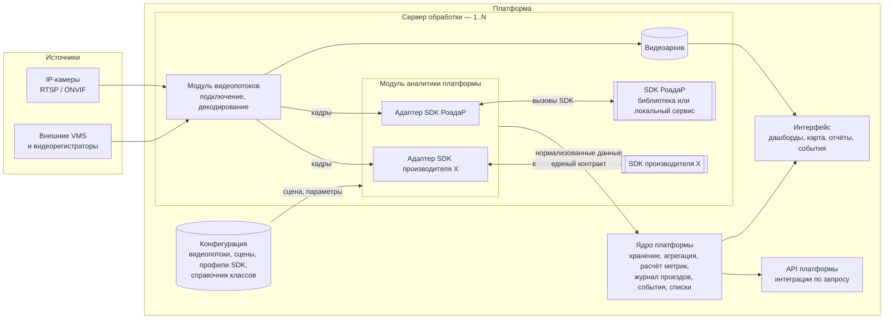
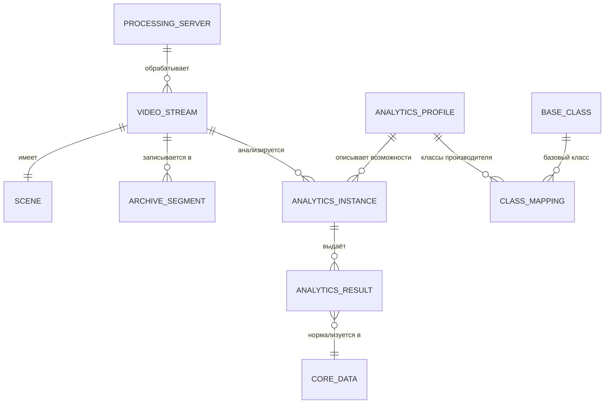

# Ревью спецификации: план правок от 01.10.2026

| Атрибут | Значение |
|---|---|
| Объект ревью | `Specifications/Traffic_Specification.MD`, версия 0.1 |
| Редакция ревью | 2 (учтены архитектурные уточнения и ответы заказчика от 01.10.2026) |
| Входные данные | 1) Ответы заказчика на вопросы спецификации и ревью (01.10.2026). 2) Возможности аналитики «Анализ трафика» — далее **«Аналитика от РоадаР»** ([страница документации](https://docs.itvgroup.ru/confluence/spaces/auto70ru/pages/337544885/), ред. от 05.05.2026) |
| Цель | Перевести спецификацию на модель «платформа + модули аналитики на SDK производителей», закрыть отвеченные вопросы, добавить метрики качества |
| Результат | Спецификация версии 0.2 |

---

## 1. Ключевой вывод

Спецификация 0.1 написана так, будто всё (детекция, классификация, распознавание ГРЗ, события) делает само ПО. Из ответов заказчика следует другая модель:

- **Платформа** — единое ПО. Она владеет видеопотоками, архивом, сценами, данными, событиями, отчётами и интерфейсом.
- **Аналитика** — не отдельное ПО, а **SDK/API производителя**, который платформа использует через свой **модуль аналитики**. На входе SDK — кадры видеопотока от платформы и настройки сцены, на выходе — аналитическая информация (объекты, классы, треки, события, метрики).
- **Производителей SDK может быть несколько**, на одном видеопотоке одновременно может работать несколько SDK. Базовые функции у всех схожи, различаются в основном детальные классы ТС и перечень событий.
- **Классы ТС, распознавание и дообучение моделей — зона производителя SDK.** Платформа сопоставляет классы производителя со своими базовыми классами.

### 1.1 Архитектурная схема

### 1.2 Сущности платформы

| Сущность | Описание | Изменение относительно 0.1 |
|---|---|---|
| **Видеопоток** | Источник видео платформы: IP-камера (RTSP/ONVIF) или поток из внешней VMS. Атрибуты: параметры подключения, место установки, координаты, направление обзора, сервер обработки, настройки архива | Был «канал» с назначением; назначение убирается |
| **Сцена** | Зоны, линии, полосы, стоп-линии, калибровка. Задаётся в редакторе платформы и передаётся в SDK в его формате | Без изменений по составу, уточнено место хранения |
| **Видеоархив** | Полная запись видеопотоков со сроком хранения; из него вырезаются фрагменты проездов и событий | Новая сущность |
| **Сервер обработки** | Компьютер, на котором работают модуль видеопотоков, модуль аналитики и SDK. Количество не ограничено | Новая сущность |
| **Профиль аналитики (SDK)** | Описание SDK производителя: версия, способ исполнения, поддерживаемые классы, признаки, события, метрики потока, параметры сцены, требования к оборудованию, метрики качества | Новая сущность |
| **Экземпляр аналитики** | Привязка SDK к видеопотоку с параметрами (какие детекторы включены, пороги) | Новая сущность |
| **Справочник соответствия классов** | Класс производителя → базовый класс платформы → класс методики учёта | Новая сущность |
| **Аналитический результат** | Данные, полученные от SDK и приведённые к единому контракту платформы | Новая сущность |

### 1.3 Распределение ответственности

| Функция | Платформа | SDK производителя |
|---|---|---|
| Подключение к камере / VMS, декодирование, архив | ✔ | — |
| Редактор сцены, хранение зон и линий | ✔ | Принимает сцену от платформы |
| Детекция, трекинг, классификация, атрибуты ТС | — | ✔ |
| Распознавание ГРЗ | — | ✔ |
| Детекторы событий (ДТП, остановка, встречное движение и т. д.) | — | ✔ |
| Параметры потока (интенсивность, V85, занятость, очереди, картограммы) | ✔, если SDK их не выдаёт — расчёт по трекам SDK | ✔, если поддерживает |
| Сопоставление классов, агрегация, хранение | ✔ | — |
| Журнал проездов, списки контроля, аномалии по ГРЗ, маршруты | ✔ (по проездам от SDK) | — |
| Карточки и обработка событий, оповещения | ✔ | — |
| Дашборды, карта, отчёты, прогноз | ✔ | — |
| Дообучение моделей, пополнение справочника марок | — | ✔ |
| Интеграции с внешними системами | ✔ (по запросу) | — |

---

## 2. Анализ «Аналитики от РоадаР»

### 2.1 Заявленные функции и их покрытие спецификацией

| № | Функция по документации | Требование спецификации | Покрытие |
|---|---|---|---|
| R-01 | Обнаружение ТС в зоне работы детектора | FR-DET-01, FR-SRC-02.2 | Есть |
| R-02 | Уплотнение потока и резкое снижение пропускной способности **по каждой полосе** | FR-FLW-09 (уровень загрузки участка), FR-EVT-01.3 (затор) | Частично: в спецификации загрузка считается по участку, а не по полосе; нет события «снижение пропускной способности» |
| R-03 | Намеренная остановка ТС на проезжей части, автострадах и в местах, где остановка запрещена | FR-EVT-01.1, FR-EVT-02.6 | Есть |
| R-04 | Падение средней скорости потока | — | **Нет в спецификации**, добавить как тип события |
| R-05 | Движение в запрещённом направлении относительно заданных границ | FR-EVT-01.4 | Есть |
| R-06 | Определение класса ТС (25 подклассов в 8 группах, см. 2.2) | FR-CLS-01, табл. 1 | Классификации не совпадают, см. 2.2 |
| R-07 | Регистрация превышения максимально допустимой скорости | FR-FLW-06.1 | Частично: в спецификации это счётчик, у РоадаР — регистрируемое событие |
| R-08 | Обнаружение ДТП | FR-EVT-01.2 | Есть |
| R-09 | Обнаружение потерянного груза | FR-EVT-01.6 | Есть |
| R-10 | Отчёты: «Web-подсистема отчётов» (ставится отдельно) и интерфейсный объект «Монитор анализа трафика» | FR-ANL-05 | Это средства исходного продукта, в котором работает модуль. В нашей платформе отчёты строит ядро по данным SDK; из SDK нужны только данные |

**В документации РоадаР не заявлено** (запросить у производителя, Q-R01). По решению заказчика параметры потока, которых нет в SDK, платформа считает сама по трекам — если SDK отдаёт треки.

| Функция спецификации | ID | Если в SDK нет |
|---|---|---|
| Интенсивность по полосам и направлениям, картограммы, матрицы корреспонденций | FR-FLW-01 … 03 | Платформа считает по трекам |
| Мгновенная и средняя скорость, V85 | FR-FLW-06 | Платформа считает по трекам и калибровке |
| Занятость, интервалы, плотность, очереди | FR-FLW-07, 08 | Платформа считает по трекам |
| Пешеходы как объект детекции | FR-DET-01, FR-FLW-10 | Нужен другой SDK |
| Виртуальный детектор для светофорного объекта (≤ 200 мс) | FR-FLW-11 | Платформа по трекам, если задержка SDK позволяет |
| Атрибуты ТС: цвет, тип кузова, марка, модель; признаки ДОПОГ, такси, маячки | FR-CLS-03, 04 | Нужен другой SDK |
| Распознавание ГРЗ | FR-LPR-01 … 05 | Нужен другой SDK |
| Пешеход или животное на дороге, дым и пламя | FR-EVT-01.5, 01.7 | Нужен другой SDK |
| Нарушения ПДД, кроме остановки, встречного направления и превышения скорости | FR-EVT-02 | Нужен другой SDK |

Вывод: SDK РоадаР покрывает **детекцию, классификацию и базовые события потока**. Распознавание ГРЗ, атрибуты ТС и большинство нарушений ПДД будут закрываться другими SDK на тех же видеопотоках.

### 2.2 Классификация РоадаР в сравнении с таблицей 1 спецификации

| Группа РоадаР | Подкласс РоадаР | Базовый класс спецификации (предложение маппинга) | Замечание |
|---|---|---|---|
| Лёгкие | Легковые машины | 1 Легковой | |
| Лёгкие | Легковые машины с прицепом | 1 Легковой + признак «прицеп» | В спецификации нет; по п. 5 табл. 1 «автопоезд» — только грузовые |
| Средние | Автобусы особо малого класса | 6 Автобус (малый) | Подтверждает TBD-09 (малые автобусы отдельно) |
| Средние | Грузовые до 5 т | 2 Лёгкий коммерческий / 3 Грузовой средний | **Граница 5 т не совпадает с 3,5 т** в спецификации |
| Грузовые | Автобусы малого класса | 6 Автобус (малый) | Автобус в группе «Грузовые»: группировка по габаритам, а не по назначению |
| Грузовые | Двухосные грузовые ТС | 3 Грузовой средний | Критерий — оси, а не масса |
| Грузовые | Трёхосные грузовые ТС | 4 Грузовой тяжёлый | Критерий — оси, а не масса |
| Грузовые | Спецтехника | 11 Спецтехника | |
| Большие ТС | Автобусы среднего класса | 6 Автобус | |
| Большие ТС | Трамвай | — | **Нет в спецификации** |
| Большие ТС | Троллейбусы | — | **Нет в спецификации** |
| Большие ТС | Грузовик или автобус с прицепом | 5 Автопоезд / 6 Автобус + прицеп | Смешанный класс: однозначно к одному базовому не отнести |
| Большие ТС | Крупная спецтехника | 11 Спецтехника | |
| Очень большие | Крупные автобусы | 6 Автобус (большой, сочленённый) | |
| Очень большие | Крупные автопоезда | 5 Автопоезд | |
| Мототехника | Мотоциклы / мопеды / квадроциклы / трициклы | 7 Мотоцикл | Квадро- и трициклы в спецификации не упомянуты |
| Мототехника | Велосипеды | 8 Велосипед | У РоадаР велосипед — разновидность мототехники |
| Мототехника | Самокат | 9 СИМ | |
| Спецтехника | Легковые машины / Микроавтобусы / Грузовые / Прочие | 1, 2, 3, 6 + признак «спецслужба»? | **Неясно**, что значит группа: оперативные службы (FR-CLS-03.2) или спецтранспорт по назначению (Q-R02) |
| Самосвалы | Двух-, трёх-, четырёхосные самосвалы | 3 / 4 Грузовой + тип кузова «самосвал» | В спецификации нет; важно для контроля грузового транспорта (FR-LPR-12) |

Выводы для спецификации:

1. **Классификации производителей принципиально различаются**: по массе (спецификация), по габаритам и осям (РоадаР), по назначению. Жёстко зашитая таблица 1 не подойдёт ни одному SDK целиком.
2. Маппинг делается **на уровне подкласса производителя**, а не группы: группа РоадаР «Большие ТС» содержит и автобусы, и грузовики, и трамваи.
3. Нужны базовые классы, которых нет в спецификации: **городской электротранспорт** (трамвай, троллейбус) и **«не классифицировано»**.
4. Часть смысла классов РоадаР лучше передавать **признаками**, а не классами: прицеп, число осей, самосвал, спецслужба.
5. Пешеходов в классификации РоадаР нет, поэтому класс 10 таблицы 1 доступен только при наличии SDK, который их детектирует.

---

## 3. План правок спецификации

Приоритет: **P1** — без этого спецификация не отражает решения заказчика; **P2** — существенное улучшение; **P3** — уточнение.

### 3.1 Архитектура: платформа, видеопотоки, модуль аналитики и SDK

| № | Приоритет | Правка | Где в спецификации |
|---|---|---|---|
| 1 | P1 | Добавить раздел «Архитектура» со схемой и таблицами из разделов 1.1–1.3 этого ревью: платформа владеет видеопотоками и данными; аналитика — SDK/API производителя, используемый модулем аналитики платформы; вход SDK — кадры и сцена, выход — аналитическая информация. | Новый раздел после раздела 1 |
| 2 | P1 | **Видеопоток — сущность платформы.** Платформа подключается к источнику, декодирует поток и передаёт в SDK кадры; SDK к камере напрямую не подключается. | Новый раздел «Видеопотоки», термины |
| 3 | P1 | Способ исполнения SDK — **библиотека внутри модуля аналитики или локальный сервис производителя на сервере обработки**; фиксируется в профиле SDK. Платформа поддерживает оба варианта. | Раздел «Архитектура», раздел «Профили аналитики» |
| 4 | P1 | На один видеопоток можно назначить **несколько SDK одновременно**; кадры декодируются один раз и передаются всем назначенным SDK. | Раздел «Видеопотоки», FR-SRC-01.1 |
| 5 | P1 | Ввести **профиль аналитики (SDK)**: производитель, версия, способ исполнения, формат входных кадров, поддерживаемые классы и признаки, типы событий, выдаваемые параметры потока, поддерживаемые элементы сцены, требования к оборудованию и камерам, метрики качества. | Новый раздел «Профили аналитики» + термины |
| 6 | P1 | Каждому требованию добавить колонку **«Тип»**: «Платформа» — реализуется всегда; «SDK» — доступно, если заявлено в профиле; «Платформа / SDK» — берётся из SDK, иначе считается платформой. Если функция недоступна, она скрыта в интерфейсе, а в отчётах показывается «нет данных» без ошибок. | Все таблицы требований |
| 7 | P1 | Описать **единый контракт данных** «SDK → платформа»: объект (ID трека, класс производителя, рамка, время кадра, признаки, уверенность), трек, проезд с ГРЗ, событие (тип, время, зона, связанные объекты, ключевые кадры), метрики потока. Видеофрагменты к событиям вырезает платформа из своего архива. | Новый раздел «Контракт данных аналитики» |
| 8 | P1 | Описать контракт «платформа → SDK»: кадры с метками времени, сцена (зоны, линии, полосы, калибровка), параметры детекторов. | Там же |
| 9 | P1 | Подключение нового SDK — это добавление адаптера в модуль аналитики и профиля, **без изменения ядра платформы**. | Раздел «Архитектура» |
| 10 | P2 | **Версионирование SDK**: смена версии модели после дообучения производителем фиксируется в данных; отчёты за период с разными версиями помечаются. | FR-CLS-05, раздел «Профили аналитики» |
| 11 | P2 | Добавить **приложение A «Профиль: Аналитика от РоадаР»** с таблицами из раздела 2 этого ревью; структуру приложения сделать шаблоном для будущих производителей. Других производителей пока нет, поэтому шаблон проектируется универсально. | Новое приложение |

### 3.2 Видеопотоки и сцены

| № | Приоритет | Правка | Где |
|---|---|---|---|
| 12 | P1 | Переименовать «видеоканал» в **«видеопоток»** по всей спецификации. Атрибуты: параметры подключения (URL, протокол, учётные данные), место установки (адрес, координаты, направление обзора), сервер обработки, настройки архива, назначенные SDK. Закрыть Q-01 и ISS-08. | FR-SRC-01, термины |
| 13 | P1 | Источники видеопотоков: **IP-камеры (RTSP/ONVIF)** и **потоки из внешних VMS и видеорегистраторов**. Обработка видеофайлов в спецификацию не входит. Закрыть GAP-10. | FR-SRC-01 |
| 14 | P1 | Убрать «назначение канала» (подсчёт / ГРЗ / события): доступные функции видеопотока определяются назначенными SDK. | FR-SRC-01.1 |
| 15 | P1 | Сцена задаётся **только в редакторе платформы**; модуль аналитики передаёт её в SDK в формате производителя. Если SDK не поддерживает какой-то элемент сцены (например, зону очереди), он недоступен для этого SDK, а параметр при возможности считает платформа. | FR-SRC-02 |
| 16 | P2 | Калибровка (FR-SRC-03) выполняется в платформе и передаётся в SDK; она же используется платформой для расчёта скорости и очередей по трекам. | FR-SRC-03 |
| 17 | P1 | Добавить **полный видеоархив**: запись всех видеопотоков, срок хранения задаётся на видеопоток или группу (дополняет FR-ADM-02), просмотр архива с наложением результатов аналитики. | Новые требования FR-SRC-04, FR-SRC-05 |
| 18 | P1 | Видеофрагмент проезда или события вырезается из архива; длительность **настраиваемая**, по умолчанию 10 с (5 с до и 5 с после). Закрыть TBD-17, Q-13. | FR-LPR-06.8, FR-EVT-04 |

### 3.3 Классификация ТС

| № | Приоритет | Правка | Где |
|---|---|---|---|
| 19 | P1 | Заменить таблицу 1 на **двухуровневый базовый классификатор платформы**: базовый класс (единый для всех SDK) → подкласс производителя (из профиля). Убрать критерии по массе из описаний базовых классов. | Раздел 7, табл. 1 |
| 20 | P1 | Предлагаемый состав базовых классов: Легковой; Лёгкий коммерческий; Грузовой; Автопоезд; Автобус; Городской электротранспорт (трамвай, троллейбус); Мототехника; Спецтехника; Велосипед; СИМ; Пешеход; Не классифицировано. Классы «Велосипед», «СИМ», «Пешеход» выделить в группу «Прочие участники движения» (закрывает ISS-01). | Раздел 7 |
| 21 | P1 | Переписать FR-CLS-01: «Класс объекта определяет SDK; платформа сопоставляет его с базовым классом по справочнику соответствия». Закрыть Q-06, Q-07, ISS-03, ISS-04. | FR-CLS-01 |
| 22 | P1 | Переписать FR-CLS-02: справочник «подкласс производителя → базовый класс → класс методики учёта» ведёт администратор без изменения кода; немаппированный класс попадает в «Не классифицировано» с оповещением администратора. | FR-CLS-02 |
| 23 | P2 | Ввести **стандартный набор признаков ТС**, не зависящий от классов: прицеп, число осей, тип кузова (в т. ч. самосвал), спецслужба, маршрутный транспорт, такси, ДОПОГ, включённые маячки. SDK передаёт те признаки, которые поддерживает. | FR-CLS-03, FR-CLS-04 |
| 24 | P2 | Правило для **смешанных классов** производителя (пример: РоадаР «Грузовик или автобус с прицепом»): маппинг на базовый класс по умолчанию + отметка «неоднозначно» в данных. | FR-CLS-02 |
| 25 | P1 | Переписать FR-CLS-05: дообучение и пополнение справочника марок и моделей выполняет **производитель SDK**; платформа обеспечивает установку новой версии SDK и обновление профиля без изменения ядра. Закрыть Q-03. | FR-CLS-05 |

### 3.4 Параметры потока и события

| № | Приоритет | Правка | Где |
|---|---|---|---|
| 26 | P1 | Для FR-FLW-01 … FR-FLW-11 зафиксировать **гибридный расчёт**: значение берётся из SDK, если SDK его выдаёт; иначе платформа считает его по трекам SDK и калибровке сцены. Источник значения сохраняется в данных. | Раздел 6 спецификации, тип «Платформа / SDK» |
| 27 | P1 | Методика учёта интенсивности и коэффициенты приведения **не фиксируются**: администратор настраивает их сам, в поставку входит шаблон по ОДМ 218.2.032-2013. Закрыть TBD-06, Q-04. | FR-FLW-04, FR-FLW-05, FR-CLS-02 |
| 28 | P1 | Сделать перечень событий **расширяемым**: базовый набор типов событий платформы + типы из профилей SDK. Тип события производителя сопоставляется с базовым типом или регистрируется как новый. | FR-EVT-01, FR-EVT-03 |
| 29 | P1 | Добавить базовые типы событий из РоадаР: **«Падение средней скорости потока»** (R-04), **«Уплотнение потока / снижение пропускной способности полосы»** (R-02), **«Превышение скорости»** как событие (R-07). | FR-EVT-01, новые подпункты 01.8 … 01.10 |
| 30 | P2 | FR-FLW-09: считать уровень загрузки **по полосе и по участку**. | FR-FLW-09 |
| 31 | P1 | Зафиксировать, что фиксация нарушений ПДД и скорости — **информационная**: она не используется для вынесения постановлений о штрафах, а платформа и SDK не являются средствами измерений утверждённого типа. Закрыть Q-05, ISS-07. | Раздел 1, FR-EVT-02, FR-FLW-06 |
| 32 | P3 | Детекцию животных, дыма и пламени перевести в тип «SDK»: не все производители это поддерживают (у РоадаР не заявлено). Закрывает ISS-05. | FR-DET-01, FR-EVT-01.5, 01.7 |

### 3.5 Параметры, зависящие от SDK и региона

| № | Приоритет | Правка | Где |
|---|---|---|---|
| 33 | P1 | Значения в квадратных скобках из ТЗ — 10 цветов, 200 км/ч, допуск 1 символ, оповещение 2 с, прогноз 60 мин, перечень стран ГРЗ — сделать **целевыми значениями**. Фактические значения фиксируются в профиле SDK. Закрыть TBD-13, TBD-15, TBD-16, TBD-19, TBD-20, TBD-25 и Q-12. | FR-CLS-04, FR-LPR-03, 04, 07.3, FR-ANL-07 |
| 34 | P1 | Ввести **региональный профиль требований** (регион или страна внедрения): целевые метрики качества, перечень стран ГРЗ, методика учёта и коэффициенты приведения. Целевые значения для одной и той же функции в разных регионах могут различаться. | Новый раздел «Региональные профили» |
| 35 | P2 | Для зарубежных внедрений предусмотреть: часовые пояса (границы суток и пикового часа считаются по местному времени видеопотока), единицы измерения (км/ч или mph), язык интерфейса и отчётов. | Раздел «Региональные профили», FR-FLW-01.1, FR-FLW-05 |

### 3.6 Интеграции

| № | Приоритет | Правка | Где |
|---|---|---|---|
| 36 | P1 | Добавить раздел «Интеграция с внешними системами»: интеграции выполняются **по запросу**, с любыми системами, в т. ч. зарубежными; протокол и формат определяются при постановке задачи. Закрыть GAP-01, Q-08, TBD-08. | Новый раздел |
| 37 | P1 | Чтобы интеграции «по запросу» не требовали переделки ядра: документированный API платформы (чтение данных, подписка на события, загрузка списков контроля, управление видеопотоками) и механизм адаптеров интеграций. | Там же |
| 38 | P2 | FR-FLW-11 (виртуальный детектор ≤ 200 мс) перевести в тип «Платформа / SDK + интеграция»: задержка зависит от SDK и протокола контроллера, который определяется при постановке задачи. | FR-FLW-11, ISS-09 |

### 3.7 Масштабирование и отказоустойчивость (новые нефункциональные требования)

| № | Приоритет | Правка | Где |
|---|---|---|---|
| 39 | P1 | Количество видеопотоков платформа не ограничивает (от 1 и более); ограничение — только производительность оборудования. Закрыть Q-10 в части количества. | Новый раздел «Нефункциональные требования» |
| 40 | P1 | **Горизонтальное масштабирование**: видеопотоки распределяются по любому количеству серверов обработки; добавление сервера не требует остановки системы и перенастройки существующих видеопотоков. | Там же |
| 41 | P1 | **Автоматическое перераспределение** видеопотоков при отказе сервера обработки на остальные серверы с достаточным запасом мощности; администратор получает оповещение. Если мощности не хватает — оповещение с перечнем необработанных видеопотоков. | Там же |
| 42 | P2 | Каждый профиль SDK содержит **методику расчёта нагрузки**: сколько видеопотоков заданного разрешения и частоты кадров обрабатывает сервер заданной конфигурации (CPU/GPU) с учётом декодирования на стороне платформы. Запросить у РоадаР (Q-R04). | Раздел «Профили аналитики» |
| 43 | P2 | Расчёт хранилища видеоархива: объём на видеопоток в зависимости от битрейта и срока хранения. | Раздел «Нефункциональные требования» |

### 3.8 Доступ и роли

| № | Приоритет | Правка | Где |
|---|---|---|---|
| 44 | P1 | Ролевая модель: **базовые роли** «Администратор», «Оператор», «Аналитик» (отчёты и дашборды), «Наблюдатель» (только просмотр) + **настраиваемые роли** с набором прав. Права ограничиваются в том числе по группам видеопотоков. Закрыть Q-09, GAP-02. | Раздел 3 «Роли», раздел 8 спецификации |
| 45 | P2 | Отдельное право на просмотр ГРЗ в открытом виде, поиск по ГРЗ и работу со списками контроля (с учётом ISS-06). | Раздел 8 спецификации |

### 3.9 Метрики качества

| № | Приоритет | Правка | Где |
|---|---|---|---|
| 46 | P1 | Добавить раздел «Метрики качества и методика испытаний» со значениями из раздела 4 этого ревью **как базовыми**; региональные профили могут их переопределять. Заменить ими TBD-01 … TBD-05, TBD-07, TBD-11, TBD-14, TBD-23. | Новый раздел + раздел 12.1 |
| 47 | P1 | Разделить метрики на **метрики SDK** (проверяются при допуске SDK нового производителя) и **метрики платформы** (задержки, производительность, доступность). | Там же |
| 48 | P2 | Процедура **допуска SDK**: испытание на эталонной выборке региона, сравнение с целевыми метриками регионального профиля, фиксация фактических значений в профиле SDK. | Раздел «Профили аналитики» |

### 3.10 Закрытие вопросов и замечаний в спецификации

| Вопрос / замечание | Решение | Правки |
|---|---|---|
| Q-01, ISS-08 | Канал = видеопоток, сущность платформы | 2, 12 |
| Q-03 | Дообучение выполняет производитель SDK | 25 |
| Q-04, TBD-06 | Методика и коэффициенты настраиваются, шаблон по ОДМ 218.2.032-2013 | 27 |
| Q-05, ISS-07 | Фиксация нарушений информационная | 31 |
| Q-06, Q-07, ISS-01, ISS-03, ISS-04 | Классы приходят от SDK, базовый классификатор + маппинг | 19–24 |
| Q-08, GAP-01, TBD-08 | Интеграции по запросу, протоколы — при постановке задачи | 36–37 |
| Q-09, GAP-02 | Базовые и настраиваемые роли | 44–45 |
| Q-10, GAP-03 | Видеопотоки не ограничены, горизонтальное масштабирование, автоматическое перераспределение | 39–43 |
| Q-11, GAP-04 | Предложенные метрики — базовые, переопределяются регионально | 46–48 |
| Q-12, TBD-13, 15, 16, 19, 20, 25 | Целевые значения, фактические — в профиле SDK | 33 |
| Q-13, TBD-17 | Видеофрагмент настраиваемый, по умолчанию 10 с | 18 |
| GAP-05 | Требования к камерам — в профиле SDK | 5 |
| GAP-10 | Источники: IP-камеры и внешние VMS; видеофайлы не обрабатываются | 13 |
| Q-02, ISS-09 | Точка отсчёта задержки 200 мс — определяется при постановке задачи на интеграцию с контроллером | 38 |
| ISS-06, Q-N01 | Доступ к открытым ГРЗ определяется региональным профилем: в РФ — по праву «Просмотр ГРЗ», в ЕС — маскирование по умолчанию. Срок хранения записи проезда настраивается, по истечении запись удаляется целиком; агрегированная статистика сохраняется | 34, 45 |
| Q-N02 | Буфер аналитических данных на сервере обработки настраивается, ограничение — свободное место на диске | 41 |
| Q-N03 | Первый региональный профиль — Россия с базовыми метриками | 34, 46 |
| Q-R01 | SDK РоадаР отдаёт треки объектов — гибридный расчёт параметров потока применим | 26 |
| Q-R02 | Группа «Спецтехника» включает и оперативные службы, и коммунальную/дорожную технику; состав определяет производитель, далее может меняться по запросу. Маппинг — на базовый класс по типу ТС + признак «спецтранспорт» | 23 |
| Q-R03 | SDK РоадаР принимает зоны и линии через API — сцена из редактора платформы передаётся в SDK | 15 |
| Q-R09 | Лицензирование SDK РоадаР — на видеопоток | 5, 42 |
| Q-R04 | Нагрузка — по факту замеров; по их результатам платформа рекомендует конфигурации оборудования | 42 (NFR-06) |
| Q-R05 (частично) | Формат кадров зависит от камеры; в профиле SDK задаётся только минимальный размер кадра. Вариант исполнения и ОС — открыты | 5, 7 (FR-SDK-03) |
| Q-R07 (частично) | Пешеходы в аналитике РоадаР не учитываются — их будет определять отдельная аналитика. Признаки «прицеп» и «число осей» — открыты | 4, 23 |
| Q-R08 | Обновления SDK выпускает производитель по своему графику или по запросу на доработку | 10, 25 (FR-SDK-05) |
| OQ-01 (GAP-09) | Аутентификация — локальные учётные записи платформы. ИБ: в платформе базовый набор (TLS, хеши паролей, аудит); класс защищённости и сертификация — по региональному профилю и проекту внедрения | 34, 44 (FR-ACC-05, NFR-09) |
| OQ-02 (GAP-08) | Веб-интерфейс с адаптивной вёрсткой для мобильных устройств; десктопное приложение не требуется | NFR-10 |
| OQ-03 | Обезличенные данные хранятся настраиваемый срок; соль хеша меняется раз в сутки; на длительное хранение остаются только агрегированные матрицы | FR-LPR-11 |
| OQ-04 (TBD-24) | Подложка подключаемая: OpenStreetMap по умолчанию, другие — настройкой; поддерживается закрытый контур через локальный тайл-сервер | FR-ANL-02.1 |
| OQ-05 (ISS-10) | Объём списков контроля не ограничивается, зависит от оборудования | NFR-08 |

---

## 4. Предлагаемые метрики качества

Значения — **базовые**, принятые заказчиком 01.10.2026. Они ориентированы на типовые показатели коммерческих аналитик. Региональный профиль (правка 34) может их переопределять. Метрики измеряются раздельно для условий: день / ночь / сложная погода (дождь, снег, туман), на эталонной выборке, размеченной вручную. Фактические значения каждого SDK фиксируются в его профиле.

### 4.1 Метрики SDK

| Метрика | Определение | День | Ночь / сложная погода | Связь |
|---|---|---|---|---|
| Точность подсчёта интенсивности | 1 − \|N_авто − N_эталон\| / N_эталон за интервал 15 мин по полосе | ≥ 95 % | ≥ 90 % | FR-FLW-01 |
| Полнота детекции ТС | Доля ТС эталона, обнаруженных SDK | ≥ 97 % | ≥ 93 % | FR-DET-01 |
| Устойчивость трекинга | Доля ТС, сопровождённых одним ID через зону учёта | ≥ 95 % | ≥ 90 % | FR-DET-02 |
| Классификация по базовым классам | Доля ТС, отнесённых к верному базовому классу | ≥ 90 % | ≥ 85 % | FR-CLS-01 |
| Классификация по подклассам производителя | То же для подклассов профиля | ≥ 80 % | ≥ 75 % | Профиль SDK |
| Погрешность скорости (информационная) | Отклонение от эталона (GPS-логгер или радар) | ±5 км/ч до 100 км/ч; ±5 % выше | то же | FR-FLW-06 |
| Распознавание ГРЗ РФ (однострочные) | Доля полностью верно распознанных ГРЗ среди читаемых | ≥ 95 % | ≥ 90 % | FR-LPR-01 |
| Распознавание ГРЗ (двухстрочные, иностранные) | То же | ≥ 90 % | ≥ 85 % | FR-LPR-02, 03 |
| Полнота выявления событий | Доля событий эталона, выявленных SDK | ≥ 90 % | ≥ 80 % | FR-EVT-01 |
| Ложные срабатывания событий | Количество ложных событий на видеопоток в сутки по каждому типу | ≤ 5 | ≤ 10 | FR-EVT-01 |

Если параметр потока считает платформа по трекам SDK (правка 26), к нему применяются те же целевые значения, а проверяется связка «SDK + платформа».

### 4.2 Метрики платформы и интеграции

| Метрика | Базовое значение | Связь |
|---|---|---|
| Задержка от события в кадре до появления карточки у оператора | ≤ 5 с | FR-EVT-04 |
| Задержка оповещения о совпадении со списком контроля | ≤ 2 с от получения проезда от SDK | FR-LPR-07.3 |
| Задержка сигнала виртуального детектора | ≤ 200 мс (из ТЗ); зависит от SDK и протокола | FR-FLW-11 |
| Поиск по журналу проездов | ≤ 5 с для периода до 30 суток | FR-LPR-08 |
| Расхождение времени между серверами | ≤ 10 мс (NTP) | FR-LPR-06.2, GAP-06 |
| Время перераспределения видеопотоков при отказе сервера | ≤ 60 с | Правка 41 |
| Доступность платформы | ≥ 99,5 % в месяц | Нефункциональные требования |
| Ошибка прогноза интенсивности | MAPE ≤ 15 % на горизонте 15 мин, ≤ 25 % на 60 мин | FR-ANL-07 |
| Потеря аналитических данных при кратковременном обрыве связи сервера обработки с ядром | 0 (буферизация на сервере обработки, *глубину буфера уточнить*) | Нефункциональные требования |

Прогноз перенесён в метрики платформы: прогноз считает платформа по данным SDK.

### 4.3 Методика испытаний (кратко)

1. Эталонная выборка: не менее 1 ч видео на каждый тип сцены (перекрёсток, магистраль, тоннель — при наличии) и условия (день, ночь, осадки) из архива платформы; разметка вручную двумя разметчиками.
2. Для скорости — заезды эталонного ТС с GPS-логгером или сравнение с поверенным радаром.
3. Результаты испытаний каждого SDK сохраняются в его профиле с датой, версией SDK и регионом.

---

## 5. Открытые вопросы

> **Статус на 01.10.2026, 16:45.** Все вопросы к заказчику закрыты (Q-N01 … Q-N03, OQ-01 … OQ-05). Из вопросов к РоадаР закрыты Q-R01 … Q-R04, Q-R08, Q-R09; частично — Q-R05 и Q-R07. Решения — в таблице 3.10. Открытыми остаются только вопросы к производителю:
> - Q-R05 — вариант исполнения SDK (библиотека / локальный сервис), поддерживаемые ОС, минимальный размер кадра;
> - Q-R06 — фактические метрики качества и требования к камерам;
> - Q-R07 — передаются ли признаки «прицеп» и «число осей» отдельно от класса.
>
> Актуальная спецификация — версия 0.3: `Specifications/Traffic_Specification.MD`. Предыдущие версии: `Specifications/Archive/Traffic_Specification_v0.1.MD`, `Specifications/Archive/Traffic_Specification_v0.2.MD`.

### 5.1 К производителю «Аналитики от РоадаР»

| ID | Вопрос |
|---|---|
| Q-R01 | Какие параметры потока выдаёт SDK: интенсивность по полосам и направлениям, мгновенная и средняя скорость, занятость, плотность, очереди? **Отдаёт ли SDK треки объектов** (нужно для расчёта на стороне платформы)? |
| Q-R02 | Что означает группа «Спецтехника» (легковые, микроавтобусы, грузовые, прочие): оперативные службы, коммунальная техника или иное? |
| Q-R03 | Принимает ли SDK зоны, линии, полосы и калибровку через API? В каком формате? |
| Q-R04 | Сколько видеопотоков (разрешение, FPS) обрабатывает сервер какой конфигурации? Нужен ли GPU? |
| Q-R05 | Какой формат входных кадров принимает SDK (сырые кадры, цветовое пространство, разрешение, FPS)? Варианты исполнения: библиотека, локальный сервис, поддерживаемые ОС? |
| Q-R06 | Каковы фактические метрики качества (подсчёт, классификация, события) и требования к камерам (угол, высота, разрешение)? |
| Q-R07 | Детектируются ли пешеходы? Передаются ли признаки «прицеп» и «число осей» отдельно от класса? |
| Q-R08 | Как часто выходят обновления моделей и меняется ли при этом перечень классов? |
| Q-R09 | Какова модель лицензирования SDK: на видеопоток, на сервер, на функцию? |

### 5.2 К заказчику

| ID | Вопрос |
|---|---|
| Q-N01 | Модель защиты ГРЗ с учётом 152-ФЗ и зарубежных требований (например, GDPR): кому доступны открытые ГРЗ и сколько они хранятся? (ISS-06) |
| Q-N02 | Глубина буферизации аналитических данных на сервере обработки при потере связи с ядром (предложение: 24 ч). |
| Q-N03 | Какой регион считать первым региональным профилем — Россия с базовыми метриками из раздела 4? |

---

## 6. Порядок выполнения

1. Правки P1 раздела 3.1 (архитектура, видеопоток как сущность, модуль аналитики и SDK, профиль, контракты данных) — на них опираются остальные.
2. Правки P1 разделов 3.2–3.8 и закрытие вопросов (3.10).
3. Раздел метрик (3.9) с базовыми значениями из раздела 4 и региональным профилем «Россия» (Q-N03).
4. Приложение A «Профиль: Аналитика от РоадаР» — после ответов производителя (Q-R01 … Q-R09).
5. Правки P2 и P3.
6. Выпуск спецификации версии 0.2 и обновление матрицы трассировки.
