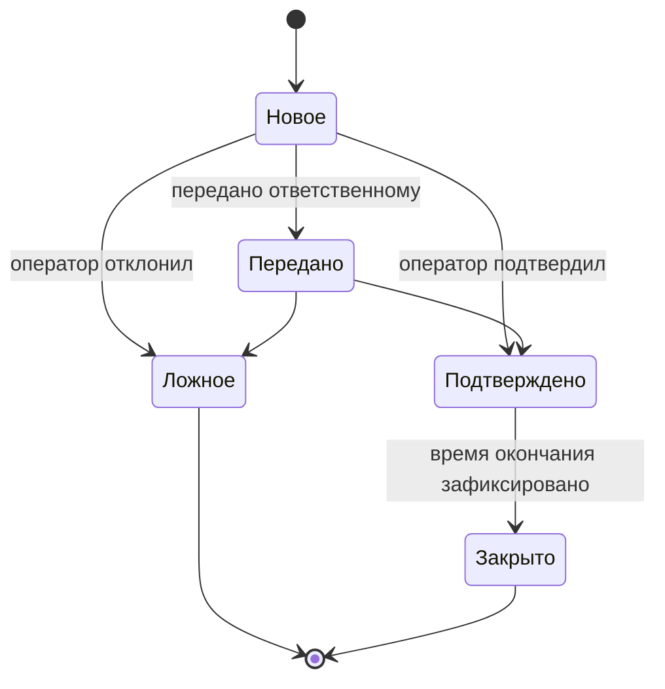
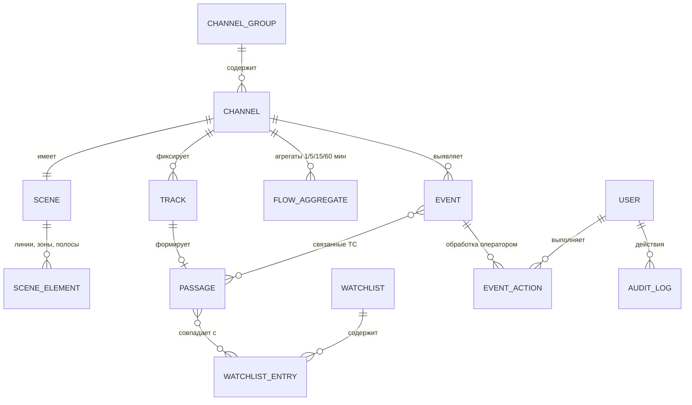

# Спецификация функциональных требований: ПО видеоаналитики транспортных потоков

| Атрибут | Значение |
|---|---|
| Исходный документ | `Трафик фукциональные требования.docx` (автор: Andrey Khristoforov, ред. 3, 28.09.2026) |
| Версия спецификации | 0.1 (черновик на согласование) |
| Дата | 30.09.2026 |
| Статус | Требует закрытия открытых вопросов (раздел 12) |

**Легенда**

- `FR-XXX-NN` — идентификатор функционального требования; `FR-XXX-NN.M` — подпункт перечня.
- **Источник** — пункт исходного ТЗ.
- `TBD-NN` — параметр, не определённый в ТЗ (в ТЗ указан в `[квадратных скобках]` или пропущен). Значения в скобках — предварительные, из ТЗ.
- *Курсивом* в критериях приёмки — предложения аналитика, отсутствующие в ТЗ; требуют согласования.
- Модальность: «должно» — обязательное требование; «[опционально]» — элемент, взятый в ТЗ в квадратные скобки.

---

## 1. Назначение и область применения

ПО предназначено для автоматического анализа видеопотоков с дорожных камер и обеспечивает:

1. обнаружение и сопровождение транспортных средств (ТС), пешеходов, велосипедистов и пользователей СИМ;
2. подсчёт и измерение параметров транспортных потоков;
3. классификацию ТС и определение их атрибутов;
4. распознавание государственных регистрационных знаков (ГРЗ);
5. выявление дорожных событий и нарушений ПДД;
6. аналитику, отчётность и прогнозирование;
7. обмен данными с внешними системами (*в ТЗ заявлено во вводной части, но отдельного раздела нет — см. GAP-01*).

## 2. Термины и сокращения

| Термин | Определение |
|---|---|
| ТС | Транспортное средство |
| ГРЗ | Государственный регистрационный знак |
| СИМ | Средство индивидуальной мобильности (электросамокат, моноколесо и т. п.) |
| ДОПОГ | Европейское соглашение о международной дорожной перевозке опасных грузов |
| Канал | Видеопоток одной камеры с набором настроек сцены |
| Сцена | Совокупность разметки кадра канала: линии, зоны, полосы, калибровка |
| Трек | Последовательность положений одного объекта с уникальным идентификатором |
| Точка фиксации | Канал (или группа каналов), фиксирующий проезды с ГРЗ |
| Проезд | Запись журнала о прохождении ТС через точку фиксации |
| Интенсивность | Количество ТС, прошедших сечение за единицу времени |
| Приведённая интенсивность | Интенсивность в единицах легкового автомобиля (ед./ч) |
| V85 | Скорость, которую не превышают 85 % ТС |
| Занятость | Доля времени, в течение которой зона детекции занята ТС |
| Картограмма | Распределение ТС по направлениям движения на пересечении |
| Матрица корреспонденций | Количество перемещений между парами «въезд — выезд» (в сцене) или между точками фиксации |
| Виртуальный детектор | Программный сигнал присутствия ТС в зоне для контроллера светофорного объекта |

## 3. Роли пользователей

В ТЗ роли явно не определены; ниже — роли, упомянутые в тексте требований.

| Роль | Упоминание в ТЗ | Основные функции |
|---|---|---|
| Оператор | 5.7, 6.4, 6.5 | Получение оповещений, обработка событий, поиск по журналу |
| Администратор | 4.2 | Настройка каналов, сцен, классов, списков, сроков хранения |
| Ответственный | 6.5 | Получение переданного события |
| Получатель оповещений / отчётов | 5.7, 6.3, 7.6 | Получение уведомлений и рассылок |
| Внешняя система | 3.11, 5.7, 6.4 | Контроллер СО, источники списков, получатели карточек событий |

*Требуется ролевая модель с матрицей прав — см. GAP-02.*

---

## 4. Источники видео и настройка сцены (FR-SRC)

| ID | Требование | Источник | Критерий приёмки |
|---|---|---|---|
| FR-SRC-01 | Добавление, редактирование, удаление и группировка видеоканалов. Атрибуты канала: адрес (*URL потока и/или почтовый адрес — уточнить, Q-01*), географические координаты, направление обзора, назначение. | 1.1 | Канал создаётся, изменяется и удаляется через UI; каналы объединяются в группы; все атрибуты сохраняются и отображаются. |
| FR-SRC-01.1 | Назначение канала: подсчёт, распознавание ГРЗ, детекция событий (*допускается комбинация — уточнить*). | 1.1 | Набор доступных функций канала определяется его назначением. |
| FR-SRC-02 | Графический редактор сцены поверх кадра. | 1.2 | Элементы сцены рисуются на живом/стоп-кадре, редактируются и сохраняются в конфигурации канала. |
| FR-SRC-02.1 | Линии пересечения с направлением пересечения. | 1.2 | Учитывается только пересечение в заданном направлении. |
| FR-SRC-02.2 | Зоны детекции, в т. ч. зоны въезда и выезда. | 1.2 | Зоне назначается тип (детекция / въезд / выезд). |
| FR-SRC-02.3 | Полосы движения с номером и направлением. | 1.2 | Полоса имеет номер и вектор направления; используется в FR-FLW. |
| FR-SRC-02.4 | Стоп-линии и зоны накопления очереди. | 1.2 | Используются в FR-FLW-08, FR-EVT-02. |
| FR-SRC-02.5 | Зоны пешеходных переходов. | 1.2 | Используются в FR-FLW-10, FR-EVT-01.5, FR-EVT-02.5. |
| FR-SRC-02.6 | Зоны исключения (не анализируются). | 1.2 | Объекты в зонах исключения не детектируются и не учитываются. |
| FR-SRC-03 | Калибровка сцены по известным расстояниям (разметка, габариты объектов) для перевода координат кадра в метры и расчёта скорости. | 1.3 | После калибровки система отображает расстояния в метрах; погрешность — *TBD-01*. |

## 5. Детекция и сопровождение объектов (FR-DET)

| ID | Требование | Источник | Критерий приёмки |
|---|---|---|---|
| FR-DET-01 | Нейросетевое обнаружение ТС всех классов таблицы 1 (раздел 7), а также пешеходов, велосипедистов и пользователей СИМ. | 2.1 | Полнота и точность детекции по классам — *TBD-02*. |
| FR-DET-02 | Трекинг: уникальный ID объекта от появления до выхода из кадра, построение траектории, исключение повторного учёта одного объекта. | 2.2 | Один объект = один ID = одно срабатывание счётчика. Допустимая доля смены ID — *TBD-03*. |
| FR-DET-03 | Сохранение трека при кратковременном перекрытии другими объектами. | 2.3 | ID сохраняется при перекрытии длительностью до *TBD-04* с. |

## 6. Подсчёт ТС и параметры транспортного потока (FR-FLW)

| ID | Требование | Источник | Критерий приёмки |
|---|---|---|---|
| FR-FLW-01 | Подсчёт интенсивности по линиям и зонам раздельно по полосам, направлениям и классам ТС. | 3.1 | Точность подсчёта — *TBD-05*. |
| FR-FLW-01.1 | Агрегация за 1, 5, 15, 60 мин, сутки и произвольный период. | 3.1 | Сумма мелких интервалов равна значению крупного интервала. |
| FR-FLW-02 | Картограммы на пересечениях: количество ТС с каждого подхода по направлениям «прямо», «налево», «направо», «разворот» с разбивкой по классам. | 3.2 | Для каждого подхода сумма по направлениям равна интенсивности подхода. |
| FR-FLW-03 | Матрица корреспонденций в пределах сцены (зона въезда → зона выезда). | 3.3 | Матрица N×M по зонам въезда/выезда за выбранный период. |
| FR-FLW-04 | Приведённая интенсивность в единицах легкового автомобиля с настраиваемыми коэффициентами по классам. | 3.4 | Коэффициенты изменяются администратором без изменения кода; значения по умолчанию — *TBD-06*. |
| FR-FLW-05 | Определение пикового часа и коэффициентов суточной и недельной неравномерности. | 3.5 | Методика расчёта — *TBD-06* (та же методика, что в FR-CLS-02). |
| FR-FLW-06 | Скорость: мгновенная для каждого ТС; средняя по полосе и направлению; V85. | 3.6 | Погрешность измерения — *TBD-07*. |
| FR-FLW-06.1 | Подсчёт количества ТС, превысивших настраиваемый порог скорости. | 3.6 | Порог задаётся на канал/полосу. |
| FR-FLW-07 | Занятость полосы, интервалы между ТС, плотность потока. | 3.7 | Единицы: занятость — %, интервал — с, плотность — авт./км. |
| FR-FLW-08 | Параметры очереди в зоне накопления: длина в метрах и в ТС, время ожидания, количество остановок ТС. | 3.8 | Требует калибровки (FR-SRC-03) и зоны накопления (FR-SRC-02.4). |
| FR-FLW-09 | Уровень загрузки участка (свободное движение / плотное движение / затор) по настраиваемым порогам скорости, плотности и занятости. | 3.9 | Пороговые значения настраиваются на участок. |
| FR-FLW-10 | Отдельный учёт пешеходов на переходах, велосипедистов и пользователей СИМ, включая направление движения. | 3.10 | Счётчики не смешиваются с интенсивностью ТС. |
| FR-FLW-11 | Сигнал присутствия ТС в зоне (виртуальный детектор) для системы управления светофорными объектами с задержкой **≤ 200 мс**. | 3.11 | Задержка измеряется от *момента въезда ТС в зону на изображении до выдачи сигнала на интерфейс* (точку отсчёта уточнить, Q-02). Протокол интерфейса — *TBD-08*. |

## 7. Классификация ТС (FR-CLS)

### Таблица 1 — Классы объектов

| № | Класс | Описание | Примечание по проверке |
|---|---|---|---|
| 1 | Легковой автомобиль | В т. ч. внедорожники и минивэны | |
| 2 | Лёгкий коммерческий | Фургоны и грузовые ТС разрешённой массой до 3,5 т | Критерий по массе (ISS-03) |
| 3 | Грузовой средний | Одиночные грузовые ТС от 3,5 до 12 т | Критерий по массе; границы интервала (ISS-03) |
| 4 | Грузовой тяжёлый | Одиночные грузовые ТС свыше 12 т | Критерий по массе (ISS-03) |
| 5 | Автопоезд | Грузовые ТС с прицепом или полуприцепом | Легковой с прицепом? (ISS-04) |
| 6 | Автобус | В т. ч. маршрутные; [малые автобусы — отдельно] | Открыт вопрос о подклассе (TBD-09) |
| 7 | Мотоцикл | Мотоциклы, мопеды, мотороллеры | |
| 8 | Велосипед | Велосипеды | Не является ТС в смысле раздела 3 (ISS-01) |
| 9 | СИМ | Электросамокаты, моноколёса и иные СИМ | Не является ТС в смысле раздела 3 (ISS-01) |
| 10 | Пешеход | Учитываются отдельно от ТС | Не является ТС (ISS-01) |
| 11 | [Спецтехника] | [Дорожная и строительная техника, тракторы] | Класс опционален (TBD-10) |

| ID | Требование | Источник | Критерий приёмки |
|---|---|---|---|
| FR-CLS-01 | Отнесение каждого ТС к одному из классов таблицы 1. | 4.1 | Точность классификации по классам — *TBD-11*. |
| FR-CLS-02 | Объединение классов и настройка их соответствия классификациям методик учёта интенсивности администратором без изменения кода. | 4.2 | Методика — *TBD-06*. Маппинг классов применяется ко всем отчётам. |
| FR-CLS-03 | Дополнительные признаки ТС: | 4.3 | |
| FR-CLS-03.1 | наличие прицепа (полуприцепа); | 4.3 | |
| FR-CLS-03.2 | оперативные службы (скорая помощь, полиция, МЧС) по внешним признакам и включённым проблесковым маячкам; | 4.3 | Признак «маячок включён» фиксируется отдельно от принадлежности к службе. |
| FR-CLS-03.3 | маршрутный транспорт и такси; | 4.3 | |
| FR-CLS-03.4 | таблички перевозки опасных грузов (ДОПОГ); | 4.3 | *Распознавание кода опасности — уточнить.* |
| FR-CLS-03.5 | [опционально] количество осей — по изображению с боковой камеры. | 4.3 | Требует боковой камеры (TBD-12). |
| FR-CLS-04 | Атрибуты ТС: цвет (не менее [10] цветов — TBD-13), тип кузова (седан, хэтчбек, универсал, внедорожник, минивэн, пикап, фургон и др.), марка и модель. | 4.4 | Перечень цветов и типов кузова — закрытый справочник (*согласовать*). |
| FR-CLS-05 | Пополнение справочника марок и моделей путём дообучения без изменения кода. | 4.5 | *Кто выполняет дообучение (заказчик/поставщик), требования к разметке данных — Q-03.* |

## 8. Распознавание ГРЗ (FR-LPR)

| ID | Требование | Источник | Критерий приёмки |
|---|---|---|---|
| FR-LPR-01 | Обнаружение номерной пластины, распознавание символов и проверка на соответствие шаблону страны и типа знака. | 5.1 | Доля верно распознанных ГРЗ — *TBD-14*. |
| FR-LPR-02 | ГРЗ РФ: | 5.2 | *Соответствие ГОСТ Р 50577 — уточнить.* |
| FR-LPR-02.1 | стандартные однострочные; | 5.2 | |
| FR-LPR-02.2 | двухстрочные (мотоциклы, прицепы, ТС с квадратной нишей); | 5.2 | |
| FR-LPR-02.3 | транзитные; | 5.2 | |
| FR-LPR-02.4 | маршрутных ТС и такси; | 5.2 | |
| FR-LPR-02.5 | ТС органов внутренних дел, Вооружённых сил, дипломатических представительств. | 5.2 | |
| FR-LPR-03 | ГРЗ иностранных государств: [Беларусь, Казахстан, Армения, Кыргызстан, Узбекистан, Таджикистан, Азербайджан, Грузия, Украина, государства ЕС]. | 5.3 | Перечень — *TBD-15*. |
| FR-LPR-04 | Распознавание ГРЗ ТС при скорости до [200] км/ч. | 5.4 | Значение — *TBD-16*; требования к камере (выдержка, частота кадров) — GAP-05. |
| FR-LPR-05 | Одновременное распознавание нескольких ГРЗ в кадре, включая ГРЗ прицепа, и связывание с соответствующим ТС. | 5.5 | ГРЗ прицепа сохраняется как отдельное поле проезда ТС-тягача. |
| FR-LPR-06 | Журнал проездов. Поля записи: | 5.6 | Все поля заполняются для каждого проезда (при наличии данных). |
| FR-LPR-06.1 | ГРЗ и страна; | 5.6 | |
| FR-LPR-06.2 | дата и время с точностью до миллисекунд; | 5.6 | *Синхронизация времени (NTP) и допустимое расхождение — GAP-06.* |
| FR-LPR-06.3 | идентификатор канала, полоса, направление; | 5.6 | |
| FR-LPR-06.4 | скорость; | 5.6 | |
| FR-LPR-06.5 | класс, цвет, тип кузова, марка и модель; | 5.6 | |
| FR-LPR-06.6 | оценка уверенности; | 5.6 | *Уточнить: уверенность распознавания ГРЗ и/или классификации.* |
| FR-LPR-06.7 | обзорное изображение ТС и изображение ГРЗ; | 5.6 | |
| FR-LPR-06.8 | видеофрагмент продолжительностью *TBD-17* с. | 5.6 | В ТЗ значение пропущено («__?_с»). |
| FR-LPR-07 | Списки контроля: | 5.7 | |
| FR-LPR-07.1 | неограниченное число списков (розыск, «чёрные», «белые», разрешения на въезд) с приоритетом, сроком действия и получателями оповещений; | 5.7 | *Практический предел по числу записей — TBD-18.* |
| FR-LPR-07.2 | загрузка вручную, из файлов CSV/XLSX и автоматически через API; | 5.7 | Формат файла и API — *TBD-08*. |
| FR-LPR-07.3 | оповещение оператора при совпадении ГРЗ, в т. ч. нечётком (допуск [1] символ — TBD-19), не позднее [2] с (TBD-20) с момента проезда. | 5.7 | Время измеряется от метки времени проезда до отображения оповещения. |
| FR-LPR-08 | Поиск по журналу проездов по критериям и их сочетаниям: полный ГРЗ, часть ГРЗ с маской, период, канал, направление, класс, цвет, марка и модель. Выгрузка результатов в XLSX и PDF. | 5.8 | Время ответа поиска — *TBD-21*. Каждый поиск логируется (FR-ADM-01). |
| FR-LPR-09 | Построение маршрута ТС по последовательности проездов через точки фиксации и отображение на карте. | 5.9 | |
| FR-LPR-10 | Средняя скорость ТС на участке между двумя точками фиксации. | 5.10 | Требует известного расстояния между точками (*источник — уточнить*). |
| FR-LPR-11 | Матрицы корреспонденций между точками фиксации и фактическое время в пути по заданным маршрутам в реальном времени; ГРЗ для этих расчётов обезличиваются (хешируются). | 5.11 | В хранилище данных для расчёта отсутствуют ГРЗ в открытом виде. См. ISS-06. |
| FR-LPR-12 | Контроль въезда ТС в заданные зоны (ограничения грузового транспорта, платные и иные) с учётом класса ТС и списков разрешений. | 5.12 | Въезд ТС недопустимого класса без разрешения формирует событие. |
| FR-LPR-13 | Выявление аномалий: | 5.13 | Каждая аномалия формирует событие (FR-EVT-04). |
| FR-LPR-13.1 | «двойники» — один ГРЗ в точках, физически недостижимых за прошедшее время; | 5.13 | *Порог скорости достижимости — настраиваемый.* |
| FR-LPR-13.2 | несоответствие марки/модели сведениям о ТС с данным ГРЗ (при предоставленном доступе к таким сведениям); | 5.13 | Внешний источник — *TBD-22*. |
| FR-LPR-13.3 | многократные проезды через заданную точку за заданный период; | 5.13 | Количество и период настраиваются. |
| FR-LPR-13.4 | устойчивое совместное движение двух ТС по маршруту; | 5.13 | *Критерий «устойчивости» (число общих точек, интервал) — настраиваемый.* |
| FR-LPR-13.5 | отсутствие ГРЗ или нечитаемый ГРЗ при хорошей видимости ТС. | 5.13 | *Критерий «хорошей видимости» — определить.* |

## 9. Выявление событий и инцидентов (FR-EVT)

| ID | Требование | Источник | Критерий приёмки |
|---|---|---|---|
| FR-EVT-01 | Автоматическое выявление дорожных событий: | 6.1 | Полнота и доля ложных срабатываний — *TBD-23*. |
| FR-EVT-01.1 | остановка ТС на проезжей части сверх заданного времени; | 6.1 | |
| FR-EVT-01.2 | дорожно-транспортное происшествие; | 6.1 | |
| FR-EVT-01.3 | образование затора; | 6.1 | Согласуется с FR-FLW-09. |
| FR-EVT-01.4 | движение ТС во встречном направлении; | 6.1 | |
| FR-EVT-01.5 | пешеход или животное на проезжей части вне пешеходного перехода; | 6.1 | Детекция животных отсутствует в FR-DET-01 (ISS-05). |
| FR-EVT-01.6 | посторонний предмет или выпавший груз на проезжей части; | 6.1 | |
| FR-EVT-01.7 | дым и открытое пламя (для тоннелей). | 6.1 | |
| FR-EVT-02 | Выявление нарушений ПДД: | 6.2 | См. ISS-07 (юридическая значимость). |
| FR-EVT-02.1 | проезд на запрещающий сигнал (состояние сигнала — от контроллера или по изображению светофора); | 6.2 | Протокол контроллера — *TBD-08*. |
| FR-EVT-02.2 | выезд за стоп-линию; | 6.2 | |
| FR-EVT-02.3 | движение по полосе для маршрутных ТС и по обочине; | 6.2 | Маршрутные ТС исключаются (FR-CLS-03.3). |
| FR-EVT-02.4 | запрещённый разворот или поворот; | 6.2 | |
| FR-EVT-02.5 | непредоставление преимущества пешеходам; | 6.2 | |
| FR-EVT-02.6 | остановка или стоянка в запрещённом месте; | 6.2 | |
| FR-EVT-02.7 | непристёгнутый ремень безопасности, использование телефона водителем. | 6.2 | Требует камеры, снимающей салон (GAP-05). |
| FR-EVT-03 | Настройка для каждого типа события: зоны и расписание, пороги, минимальная длительность, приоритет, получатели оповещения. | 6.3 | |
| FR-EVT-04 | Карточка события, передаваемая оператору и во внешние системы: тип; время начала и окончания; место; связанные ТС и их ГРЗ; изображения; видеофрагмент; текущий статус. | 6.4 | Формат и протокол передачи — *TBD-08*. |
| FR-EVT-05 | Обработка события оператором: подтверждение, отклонение как ложного, комментарий, передача ответственному. | 6.5 | Каждое действие фиксируется в истории события и журнале действий (FR-ADM-01). |

**Жизненный цикл события (предложение для согласования):**

## 10. Аналитика и отчётность (FR-ANL)

| ID | Требование | Источник | Критерий приёмки |
|---|---|---|---|
| FR-ANL-01 | Настраиваемые дашборды (реальное время и история): графики интенсивности, скорости, занятости, состава потока; очереди; количество событий. | 7.1 | Пользователь добавляет/удаляет виджеты и выбирает период. |
| FR-ANL-02 | Электронная карта: точки видеофиксации, текущий уровень загрузки участков, активные события, маршруты ТС. | 7.2 | Картографическая подложка — *TBD-24*. |
| FR-ANL-03 | Тепловые карты траекторий и мест остановок ТС для канала и периода. | 7.3 | |
| FR-ANL-04 | Сравнение показателей за два произвольных периода с расчётом абсолютных и относительных изменений. | 7.4 | Пример: до/после изменения ОДД, будни/выходные. |
| FR-ANL-05 | Отчёты по шаблонам: | 7.5 | |
| FR-ANL-05.1 | интенсивность и состав потока; | 7.5 | Данные из FR-FLW-01, FR-FLW-04. |
| FR-ANL-05.2 | картограммы интенсивности на пересечениях; | 7.5 | Данные из FR-FLW-02. |
| FR-ANL-05.3 | скоростной режим; | 7.5 | Данные из FR-FLW-06. |
| FR-ANL-05.4 | события; | 7.5 | Данные из FR-EVT. |
| FR-ANL-05.5 | работоспособность каналов. | 7.5 | *Критерии работоспособности (нет сигнала, засветка, смещение камеры) — GAP-07.* |
| FR-ANL-06 | Выгрузка отчётов в XLSX, CSV и PDF; формирование по расписанию с рассылкой по e-mail. | 7.6 | |
| FR-ANL-07 | Прогноз интенсивности и уровня загрузки на горизонте до [60] мин (TBD-25) на основе исторических и текущих данных. | 7.7 | Допустимая ошибка прогноза — *TBD-25*. |

## 11. Администрирование и разграничение доступа (FR-ADM)

| ID | Требование | Источник | Критерий приёмки |
|---|---|---|---|
| FR-ADM-01 | Журнал действий пользователей, включая поисковые запросы по ГРЗ, изменения списков контроля и настроек. | 8.1 | Запись: пользователь, время, действие, объект, параметры. *Защита журнала от изменения — уточнить.* |
| FR-ADM-02 | Настройка сроков хранения по видам данных (статистика, журнал проездов, изображения, видеофрагменты) и автоматическое удаление по истечении. | 8.2 | Данные старше срока удаляются автоматически; факт удаления логируется. |

*Раздел 8 ТЗ заявляет «разграничение доступа», но требований к ролям и правам в нём нет — см. GAP-02.*

---

## 12. Результаты проверки ТЗ

### 12.1 Неопределённые параметры (TBD)

| ID | Параметр | Пункт ТЗ | Значение в ТЗ |
|---|---|---|---|
| TBD-01 | Погрешность калибровки сцены | 1.3 | не указано |
| TBD-02 | Точность/полнота детекции по классам | 2.1 | не указано |
| TBD-03 | Допустимая доля смены ID трека | 2.2 | не указано |
| TBD-04 | Длительность перекрытия, при которой сохраняется трек | 2.3 | «кратковременное» |
| TBD-05 | Точность подсчёта интенсивности | 3.1 | не указано |
| TBD-06 | Методика учёта интенсивности и коэффициенты приведения по умолчанию | 3.4, 3.5, 4.2 | «[указать методику]» |
| TBD-07 | Погрешность измерения скорости | 3.6 | не указано |
| TBD-08 | Протоколы и форматы интеграции (контроллер СО, API списков, карточки событий) | 3.11, 5.7, 6.2, 6.4 | не указано |
| TBD-09 | Выделение малых автобусов в отдельный класс | табл. 1, кл. 6 | «[малые автобусы — отдельно]» |
| TBD-10 | Включение класса «Спецтехника» | табл. 1, кл. 11 | в квадратных скобках |
| TBD-11 | Точность классификации | 4.1 | не указано |
| TBD-12 | Определение числа осей (боковая камера) | 4.3 | в квадратных скобках |
| TBD-13 | Число и перечень цветов | 4.4 | «[10]» |
| TBD-14 | Точность распознавания ГРЗ | 5.1 | не указано |
| TBD-15 | Перечень иностранных государств | 5.3 | список в квадратных скобках |
| TBD-16 | Максимальная скорость ТС для распознавания ГРЗ | 5.4 | «[200] км/ч» |
| TBD-17 | Длительность видеофрагмента проезда | 5.6 | «__?_с» — пропущено |
| TBD-18 | Практический объём списков контроля (записей) | 5.7 | «неограниченное число» |
| TBD-19 | Допуск нечёткого совпадения | 5.7 | «[1] символ» |
| TBD-20 | Максимальная задержка оповещения | 5.7 | «[2] с» |
| TBD-21 | Время отклика поиска по журналу | 5.8 | не указано |
| TBD-22 | Внешний источник сведений о ТС по ГРЗ | 5.13 | «если доступ предоставлен» |
| TBD-23 | Полнота и доля ложных срабатываний детекции событий | 6.1, 6.2 | не указано |
| TBD-24 | Картографическая подложка | 7.2 | не указано |
| TBD-25 | Горизонт и точность прогноза | 7.7 | «[60] минут», точность не указана |

### 12.2 Противоречия и неоднозначности (ISS)

| ID | Описание | Пункты ТЗ | Рекомендация |
|---|---|---|---|
| ISS-01 | Таблица 1 называется «Классы ТС», но включает пешеходов, велосипеды и СИМ; при этом п. 2.1 перечисляет их отдельно от ТС, а кл. 10 «учитываются отдельно от ТС». Непонятно, входят ли классы 8–10 в интенсивность ТС (п. 3.1) и в журнал проездов. | 2.1, 3.1, 3.10, 4.1, табл. 1 | Разделить таблицу на «Классы ТС» (1–7, 11) и «Прочие участники движения» (8–10). |
| ISS-02 | Термин «картограмма» используется и в 3.2 (функция расчёта), и в 7.5 (отчёт). Дублирования нет, но нужна явная связь. | 3.2, 7.5 | Зафиксировано: FR-ANL-05.2 использует данные FR-FLW-02. |
| ISS-03 | Классы 2–4 разграничены по разрешённой максимальной массе, которую нельзя определить по видеоизображению. Границы интервала «от 3,5 до 12 т» не указаны как включающие/исключающие. | табл. 1 | Заменить на визуальные признаки (габариты, число осей, тип кабины) или согласовать допустимую погрешность отнесения. |
| ISS-04 | Класс 5 «Автопоезд» — грузовые ТС с прицепом. Не определено, как классифицируются легковые и автобусы с прицепом. Признак прицепа есть и в 4.3. | табл. 1, 4.3 | Класс определяется тягачом; прицеп — дополнительный признак (FR-CLS-03.1). Согласовать. |
| ISS-05 | Событие «животное на проезжей части» (6.1) и «посторонний предмет», «дым/пламя» требуют детекции объектов, не перечисленных в п. 2.1. | 2.1, 6.1 | Дополнить п. 2.1 перечнем детектируемых объектов для событий. |
| ISS-06 | П. 5.11 требует хеширования ГРЗ для матриц корреспонденций, но пп. 5.6, 5.8, 5.9 хранят и отображают ГРЗ в открытом виде. Цель обезличивания неясна, если открытые ГРЗ хранятся в той же системе. | 5.6, 5.8, 5.9, 5.11 | Определить модель защиты персональных данных (152-ФЗ): кто видит открытые ГРЗ, срок хранения, соль хеша и её ротация. |
| ISS-07 | Нарушения ПДД (6.2) и измерение скорости (3.6) при использовании для привлечения к ответственности требуют средств измерений утверждённого типа и соответствия требованиям к спецтехсредствам автоматической фиксации. В ТЗ цель не указана. | 3.6, 6.2 | Указать, является ли фиксация нарушений доказательной (штрафы) или информационной (аналитика). От этого зависят сертификация и объём работ. |
| ISS-08 | «Адрес» канала в п. 1.1 может означать как адрес видеопотока, так и почтовый адрес места установки. | 1.1 | Разделить на два атрибута. |
| ISS-09 | П. 3.11: не указана точка отсчёта задержки 200 мс и интерфейс выдачи сигнала. | 3.11 | Определить методику измерения (см. FR-FLW-11). |
| ISS-10 | П. 5.7: «неограниченное число списков» непроверяемо. | 5.7 | Задать проверяемые объёмы (списков, записей). |
| ISS-11 | П. 5.3: в списке стран есть Украина и ЕС — требуется подтверждение актуальности перечня. | 5.3 | Подтвердить перечень с заказчиком. |

### 12.3 Пробелы (GAP)

| ID | Отсутствует в ТЗ | Почему важно |
|---|---|---|
| GAP-01 | Раздел «Обмен данными с внешними системами» (заявлен во вводной части): протоколы, форматы, API, список систем. | Без него невозможно реализовать 3.11, 5.7, 6.2, 6.4. |
| GAP-02 | Ролевая модель и матрица прав (заявлено «разграничение доступа» в заголовке раздела 8), аутентификация, интеграция с каталогом пользователей. | Доступ к ГРЗ и спискам розыска — чувствительные данные. |
| GAP-03 | Нефункциональные требования: число каналов, производительность, отказоустойчивость, масштабирование, требования к серверному оборудованию и GPU. | Определяет архитектуру и стоимость. |
| GAP-04 | Метрики качества (точность детекции, классификации, распознавания ГРЗ, подсчёта, скорости) и методика испытаний (эталонные выборки, условия: ночь, дождь, снег, засветка). | Без них требования разделов 2–6 не проверяемы при приёмке. |
| GAP-05 | Требования к камерам: разрешение, частота кадров, углы установки, ИК-подсветка, отдельные камеры для салона (ремень, телефон) и боковые (оси). | Качество 4.3, 5.4, 6.2 зависит от оборудования. |
| GAP-06 | Синхронизация времени между каналами и серверами. | Обязательна для 5.6 (мс), 5.10, 5.13.1. |
| GAP-07 | Мониторинг работоспособности каналов: какие неисправности выявляются (потеря сигнала, смещение/загрязнение камеры, засветка). | Нужен для отчёта 7.5. |
| GAP-08 | Требования к UI: язык, веб/десктоп, браузеры, мобильный доступ. | |
| GAP-09 | Информационная безопасность и защита персональных данных (152-ФЗ, класс защищённости, шифрование). | Система обрабатывает ГРЗ, изображения людей и маршруты ТС. |
| GAP-10 | Режим работы: только онлайн-потоки или также обработка видеоархивов/файлов. | Влияет на исследования потоков по записям. |

## 13. Модель данных (ключевые сущности)

| Сущность | Ключевые атрибуты | Требования |
|---|---|---|
| Канал | ID, группа, адрес потока, место, координаты, азимут обзора, назначение | FR-SRC-01 |
| Элемент сцены | тип, геометрия, направление, номер полосы | FR-SRC-02 |
| Трек | ID, класс, признаки, атрибуты, траектория, скорость | FR-DET, FR-CLS |
| Проезд | ГРЗ, страна, ГРЗ прицепа, время (мс), канал, полоса, направление, скорость, класс, цвет, кузов, марка/модель, уверенность, изображения, видео | FR-LPR-06 |
| Агрегат потока | канал, элемент сцены, полоса, направление, класс, интервал, интенсивность, скорость, V85, занятость, плотность, очередь | FR-FLW |
| Список контроля / запись | тип, приоритет, срок действия, получатели / ГРЗ, комментарий | FR-LPR-07 |
| Событие | тип, начало, окончание, место, статус, приоритет, изображения, видео, связанные ТС | FR-EVT-04 |
| Журнал действий | пользователь, время, действие, объект, параметры | FR-ADM-01 |

## 14. Матрица трассировки (полнота покрытия ТЗ)

Все 49 пунктов ТЗ и таблица 1 покрыты требованиями спецификации.

| Раздел ТЗ | Пункты | Требования спецификации | Покрыто |
|---|---|---|---|
| 1. Источники видео и сцена | 1.1–1.3 | FR-SRC-01 … FR-SRC-03 | 3/3 |
| 2. Детекция и сопровождение | 2.1–2.3 | FR-DET-01 … FR-DET-03 | 3/3 |
| 3. Параметры потока | 3.1–3.11 | FR-FLW-01 … FR-FLW-11 | 11/11 |
| 4. Классификация | 4.1–4.5, табл. 1 | FR-CLS-01 … FR-CLS-05, табл. 1 | 5/5 |
| 5. ГРЗ | 5.1–5.13 | FR-LPR-01 … FR-LPR-13 | 13/13 |
| 6. События | 6.1–6.5 | FR-EVT-01 … FR-EVT-05 | 5/5 |
| 7. Аналитика | 7.1–7.7 | FR-ANL-01 … FR-ANL-07 | 7/7 |
| 8. Администрирование | 8.1–8.2 | FR-ADM-01 … FR-ADM-02 | 2/2 |
| **Итого** | **49** | **49 требований верхнего уровня, 54 подпункта** | **49/49** |

## 15. Вопросы к заказчику

| ID | Вопрос | Связь |
|---|---|---|
| Q-01 | «Адрес» канала — это адрес видеопотока, почтовый адрес или оба? | ISS-08 |
| Q-02 | От какого момента отсчитывается задержка 200 мс виртуального детектора и по какому протоколу выдаётся сигнал? | FR-FLW-11, ISS-09 |
| Q-03 | Кто выполняет дообучение модели марок/моделей и в каком контуре (у заказчика или у поставщика)? | FR-CLS-05 |
| Q-04 | Какую методику учёта интенсивности и коэффициенты приведения применять? | TBD-06 |
| Q-05 | Фиксация нарушений ПДД и скорости — доказательная (для штрафов) или информационная? | ISS-07 |
| Q-06 | Классы 8–10 входят в «ТС» для подсчёта и журнала проездов? | ISS-01 |
| Q-07 | Как отличать классы 2–4 по видео, если критерий — разрешённая масса? | ISS-03 |
| Q-08 | С какими внешними системами нужна интеграция (СУДС/АСУДД, контроллеры СО, ЦАФАП, системы розыска, ФИС ГИБДД-М) и по каким протоколам? | GAP-01, TBD-08, TBD-22 |
| Q-09 | Какие роли пользователей нужны и какие у них права (в т. ч. кому доступны открытые ГРЗ)? | GAP-02, ISS-06 |
| Q-10 | Сколько каналов на старте и в перспективе, какое оборудование предполагается? | GAP-03, GAP-05 |
| Q-11 | Какие целевые метрики качества и как будут проводиться приёмочные испытания? | GAP-04 |
| Q-12 | Подтвердите значения в квадратных скобках: 10 цветов, 200 км/ч, допуск 1 символ, 2 с, 60 мин, перечень стран, малые автобусы, спецтехника, число осей. | TBD-09 … TBD-25 |
| Q-13 | Какова длительность видеофрагмента проезда? | TBD-17 |
