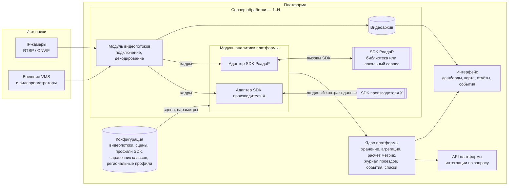
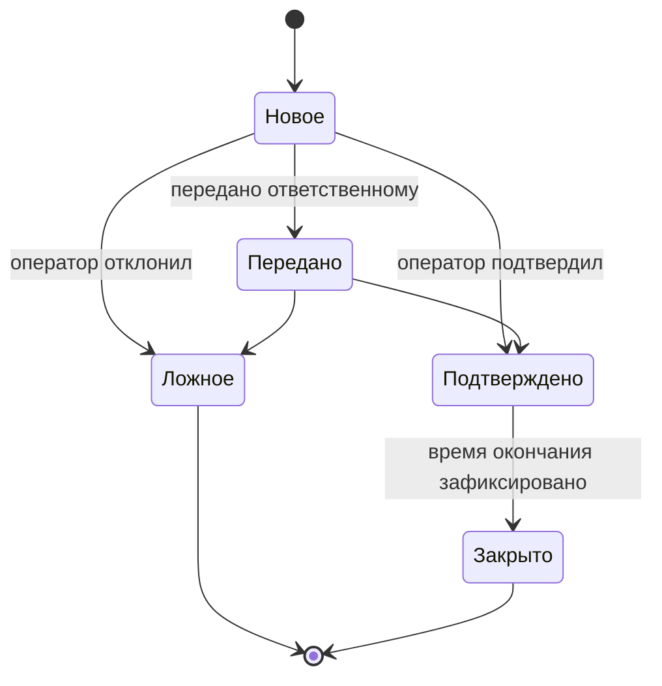
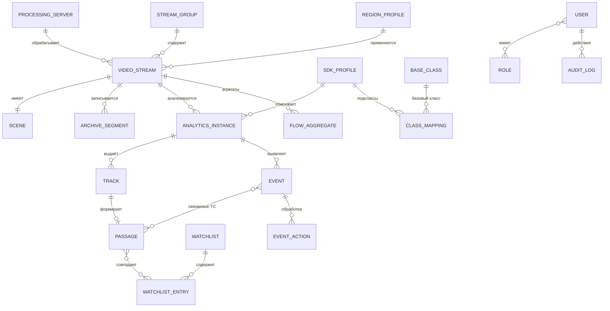

# Спецификация функциональных требований: платформа видеоаналитики транспортных потоков

| Атрибут | Значение |
|---|---|
| Исходный документ | `Трафик фукциональные требования.docx` (автор: Andrey Khristoforov, ред. 3, 28.09.2026) |
| Версия спецификации | **0.2** |
| Дата | 01.10.2026 |
| Основание изменений | Ревью `Review/2026-10-01_v1.md` (ред. 2), ответы заказчика от 01.10.2026 |
| Статус | Черновик на согласование; открытые вопросы — раздел 19 |

**История изменений**

| Версия | Дата | Изменения |
|---|---|---|
| 0.1 | 30.09.2026 | Структурирование ТЗ, проверка, вопросы к заказчику. Архив: `Specifications/Archive/Traffic_Specification_v0.1.MD` |
| 0.2 | 01.10.2026 | Модель «платформа + модули аналитики на SDK производителей»; видеопоток и видеоархив — сущности платформы; базовый классификатор и маппинг классов; профили SDK и региональные профили; интеграции, масштабирование, роли, метрики качества; приложение A «Аналитика от РоадаР» |

**Легенда**

- `FR-XXX-NN` — функциональное требование; `FR-XXX-NN.M` — подпункт; `NFR-NN` — нефункциональное требование.
- **Тип** требования:
  - **П** — реализует платформа, доступно всегда;
  - **SDK** — выполняет SDK производителя аналитики; доступно, если заявлено в профиле SDK (раздел 6);
  - **П/SDK** — значение берётся из SDK, если SDK его выдаёт; иначе платформа рассчитывает его сама по трекам SDK.
- Если функция типа SDK недоступна для видеопотока, она скрыта в интерфейсе, а в отчётах вместо значения показывается «нет данных».
- **Источник**: `ТЗ п. N` — пункт исходного ТЗ; `Р-N` — правка N из ревью от 01.10.2026.
- **Целевое значение** — требование заказчика; фактическое значение конкретного SDK фиксируется в его профиле.

---

## 1. Назначение и область применения

Платформа предназначена для автоматического анализа видеопотоков с дорожных камер и обеспечивает:

1. приём, запись и хранение видеопотоков;
2. анализ видеопотоков с помощью подключаемых SDK аналитики разных производителей;
3. подсчёт и измерение параметров транспортных потоков;
4. классификацию ТС и определение их признаков;
5. распознавание государственных регистрационных знаков (ГРЗ) и работу с журналом проездов;
6. выявление дорожных событий и нарушений ПДД;
7. аналитику, отчётность и прогнозирование;
8. интеграцию с внешними системами по запросу.

**Ограничения области применения**

- Фиксация нарушений ПДД и измерение скорости — **информационные**. Результаты не предназначены для вынесения постановлений об административных правонарушениях; платформа и SDK не являются средствами измерений утверждённого типа. (Р-31)
- Обработка видеофайлов, загружаемых пользователем, в область применения не входит. (Р-13)
- Платформа может внедряться в России и за рубежом; различия требований по регионам задаются региональными профилями (раздел 14).

## 2. Термины и сокращения

| Термин | Определение |
|---|---|
| Платформа | Разрабатываемое ПО: видеопотоки, архив, сцены, модуль аналитики, ядро, интерфейс, API |
| Ядро платформы | Компоненты хранения, агрегации, расчёта метрик, журнала проездов, событий, отчётов |
| Видеопоток | Сущность платформы: источник видео (IP-камера или поток внешней VMS) с параметрами подключения, местом установки и настройками |
| Сервер обработки | Компьютер, на котором работают модуль видеопотоков, модуль аналитики и SDK |
| Модуль аналитики | Компонент платформы, передающий кадры и сцену в SDK и приводящий результаты SDK к единому контракту данных |
| SDK аналитики | Программная библиотека или локальный сервис производителя, принимающий кадры и выдающий аналитическую информацию |
| Адаптер SDK | Часть модуля аналитики, реализующая взаимодействие с SDK конкретного производителя |
| Профиль SDK | Описание возможностей, параметров и метрик качества SDK конкретной версии |
| Экземпляр аналитики | Назначение SDK на видеопоток с набором параметров |
| Базовый класс | Класс объекта платформы, единый для всех SDK |
| Подкласс производителя | Класс объекта, выдаваемый SDK |
| Региональный профиль | Набор требований, зависящих от страны или региона внедрения |
| Сцена | Зоны, линии, полосы, стоп-линии и калибровка видеопотока |
| Трек | Последовательность положений одного объекта с уникальным идентификатором |
| Точка фиксации | Видеопоток (или группа видеопотоков), фиксирующий проезды с ГРЗ |
| Проезд | Запись журнала о прохождении ТС через точку фиксации |
| ТС, ГРЗ, СИМ, ДОПОГ | Транспортное средство; государственный регистрационный знак; средство индивидуальной мобильности; соглашение о перевозке опасных грузов |
| VMS | Video Management System — внешняя система видеонаблюдения |
| Интенсивность, приведённая интенсивность | Количество ТС за единицу времени; то же в единицах легкового автомобиля |
| V85 | Скорость, которую не превышают 85 % ТС |
| Занятость | Доля времени, в течение которой зона детекции занята ТС |
| Картограмма | Распределение ТС по направлениям движения на пересечении |
| Матрица корреспонденций | Количество перемещений между парами «въезд — выезд» или между точками фиксации |
| Виртуальный детектор | Сигнал присутствия ТС в зоне для контроллера светофорного объекта |

## 3. Архитектура

### 3.1 Принципы

1. Платформа владеет видеопотоками, архивом, сценами, данными, событиями, отчётами и интерфейсом. (Р-1, Р-2)
2. Аналитика — SDK производителя, который платформа использует через модуль аналитики. Вход SDK — кадры видеопотока и сцена от платформы; выход — аналитическая информация. SDK к камере напрямую не подключается. (Р-1, Р-2)
3. SDK исполняется как библиотека внутри модуля аналитики или как локальный сервис производителя на сервере обработки; способ фиксируется в профиле SDK. (Р-3)
4. На один видеопоток можно назначить несколько SDK; кадры декодируются один раз и передаются всем назначенным SDK. (Р-4)
5. Подключение SDK нового производителя — это добавление адаптера и профиля, без изменения ядра платформы. (Р-9)
6. Количество видеопотоков и серверов обработки платформой не ограничивается. (Р-39, Р-40)

### 3.2 Схема

### 3.3 Распределение ответственности

| Функция | Платформа | SDK |
|---|---|---|
| Подключение к камере / VMS, декодирование, архив | ✔ | — |
| Редактор сцены, хранение зон и линий, калибровка | ✔ | Принимает сцену от платформы |
| Детекция, трекинг, классификация, признаки ТС | — | ✔ |
| Распознавание ГРЗ | — | ✔ |
| Детекторы событий в кадре (ДТП, остановка, встречное движение и т. д.) | — | ✔ |
| Параметры потока (интенсивность, скорость, занятость, очереди, картограммы) | ✔, если SDK не выдаёт — по трекам | ✔, если поддерживает |
| Сопоставление классов, агрегация, хранение | ✔ | — |
| Журнал проездов, списки контроля, аномалии по ГРЗ, маршруты | ✔ | — |
| Карточки и обработка событий, оповещения | ✔ | — |
| Дашборды, карта, отчёты, прогноз | ✔ | — |
| Дообучение моделей, пополнение справочника марок и моделей | — | ✔ |
| Интеграции с внешними системами | ✔ | — |

## 4. Роли и разграничение доступа (FR-ACC)

| ID | Тип | Требование | Источник | Критерий приёмки |
|---|---|---|---|---|
| FR-ACC-01 | П | Базовые роли: **Администратор** (настройка платформы), **Оператор** (оповещения, события, поиск), **Аналитик** (дашборды, отчёты, сравнение периодов), **Наблюдатель** (только просмотр). | Р-44 | Роли поставляются преднастроенными. |
| FR-ACC-02 | П | Настраиваемые роли с произвольным набором прав, в т. ч. ограничение доступа по группам видеопотоков. | Р-44 | Администратор создаёт роль и назначает ей права без изменения кода. |
| FR-ACC-03 | П | Отдельные права: просмотр ГРЗ в открытом виде, поиск по ГРЗ, ведение списков контроля, просмотр видеоархива, выгрузка данных. | Р-45 | Без права «Просмотр ГРЗ» ГРЗ отображается маскированным. |
| FR-ACC-04 | П | Режим отображения ГРЗ по умолчанию задаётся региональным профилем: для России — по праву «Просмотр ГРЗ»; для ЕС — маскирование по умолчанию. | Р-45, ответ на Q-N01 | Смена регионального профиля меняет режим отображения. |

## 5. Видеопотоки, видеоархив и сцена (FR-SRC)

| ID | Тип | Требование | Источник | Критерий приёмки |
|---|---|---|---|---|
| FR-SRC-01 | П | Добавление, редактирование, удаление и группировка видеопотоков. | ТЗ 1.1, Р-12 | Операции доступны в интерфейсе и через API. |
| FR-SRC-01.1 | П | Атрибуты видеопотока: параметры подключения (URL, протокол, учётные данные), место установки (адрес, координаты, направление обзора), сервер обработки, настройки архива, назначенные SDK. | ТЗ 1.1, Р-12, Р-14 | Атрибуты сохраняются; видеопоток отображается на карте по координатам. |
| FR-SRC-01.2 | П | Источники: IP-камеры (RTSP/ONVIF), потоки внешних VMS и видеорегистраторов. | Р-13 | Видеопоток подключается из каждого типа источника. |
| FR-SRC-01.3 | П | Назначение на видеопоток одного или нескольких SDK; доступные функции видеопотока определяются профилями назначенных SDK. | Р-4, Р-14 | Два SDK на одном видеопотоке работают одновременно, поток декодируется один раз. |
| FR-SRC-02 | П | Графический редактор сцены поверх кадра. Сцена хранится в платформе и передаётся в SDK в формате производителя. Элементы, которые SDK не поддерживает, для него недоступны. | ТЗ 1.2, Р-15 | Сцена, заданная в платформе, применяется в SDK без ручной настройки в средствах производителя. |
| FR-SRC-02.1 | П | Линии пересечения с направлением пересечения. | ТЗ 1.2 | |
| FR-SRC-02.2 | П | Зоны детекции, в т. ч. зоны въезда и выезда. | ТЗ 1.2 | |
| FR-SRC-02.3 | П | Полосы движения с номером и направлением. | ТЗ 1.2 | |
| FR-SRC-02.4 | П | Стоп-линии и зоны накопления очереди. | ТЗ 1.2 | |
| FR-SRC-02.5 | П | Зоны пешеходных переходов. | ТЗ 1.2 | |
| FR-SRC-02.6 | П | Зоны исключения (не анализируются). | ТЗ 1.2 | Объекты в зонах исключения не учитываются. |
| FR-SRC-03 | П | Калибровка сцены по известным расстояниям (разметка, габариты объектов) для перевода координат кадра в метры. Калибровка передаётся в SDK и используется платформой для расчёта по трекам. | ТЗ 1.3, Р-16 | Погрешность — через метрику скорости (раздел 18). |
| FR-SRC-04 | П | Полная запись видеоархива по каждому видеопотоку; срок хранения задаётся на видеопоток или группу. | Р-17 | Архив удаляется автоматически по истечении срока. |
| FR-SRC-05 | П | Просмотр архива с наложением результатов аналитики (рамки, треки, классы, события). | Р-17 | |
| FR-SRC-06 | П | Вырезка видеофрагментов проездов и событий из архива; длительность настраиваемая, по умолчанию 10 с (5 с до и 5 с после). | Р-18 | Фрагмент доступен из карточки проезда и события. |
| FR-SRC-07 | П/SDK | Контроль работоспособности видеопотоков: потеря сигнала, падение частоты кадров (платформа); засветка, загрязнение, смещение камеры (SDK, если поддерживает). Неисправность формирует событие. | ТЗ 7.5 | Данные используются в отчёте FR-ANL-05.5. |

## 6. Модуль аналитики и профили SDK (FR-SDK)

| ID | Тип | Требование | Источник | Критерий приёмки |
|---|---|---|---|---|
| FR-SDK-01 | П | Модуль аналитики передаёт в SDK кадры с метками времени, сцену и параметры детекторов; получает результаты и приводит их к единому контракту данных (6.1). | Р-7, Р-8 | |
| FR-SDK-02 | П | Поддержка SDK в виде библиотеки и в виде локального сервиса. | Р-3 | |
| FR-SDK-03 | П | Профиль SDK для каждой версии SDK: производитель, версия, способ исполнения, формат входных кадров, поддерживаемые элементы сцены, классы и признаки, типы событий, выдаваемые параметры потока, модель лицензирования, требования к оборудованию и камерам, методика расчёта нагрузки, фактические метрики качества. | Р-5, Р-42 | Структура профиля — приложение A. |
| FR-SDK-04 | П | Подключение SDK нового производителя добавлением адаптера и профиля без изменения ядра платформы. | Р-9 | |
| FR-SDK-05 | П | Установка новой версии SDK (в т. ч. после дообучения производителем) и обновление профиля без изменения ядра. Версия SDK сохраняется в каждом аналитическом результате; отчёты за период с разными версиями помечаются. | ТЗ 4.5, Р-10, Р-25 | |
| FR-SDK-06 | П | Учёт лицензий SDK по модели лицензирования из профиля (например, на видеопоток). | Ответ на Q-R09 | Назначение SDK сверх числа лицензий блокируется с сообщением. |
| FR-SDK-07 | П | Процедура допуска SDK: испытание на эталонной выборке региона, сравнение с целевыми метриками регионального профиля, запись фактических значений в профиль SDK. | Р-48 | Протокол допуска хранится в профиле. |

### 6.1 Единый контракт данных

**Платформа → SDK**

| Данные | Состав |
|---|---|
| Кадр | Изображение, метка времени (мс), ID видеопотока |
| Сцена | Зоны, линии, полосы, стоп-линии, зоны очереди и переходов, зоны исключения, калибровка |
| Параметры | Включённые детекторы, пороги, расписание |

**SDK → платформа**

| Данные | Состав |
|---|---|
| Объект | ID трека, подкласс производителя, рамка, метка времени кадра, признаки, уверенность |
| Трек | Последовательность положений объекта, время входа и выхода из кадра |
| Проезд с ГРЗ | ГРЗ, страна, тип знака, ГРЗ прицепа, ID трека, уверенность, изображение ГРЗ, обзорное изображение |
| Событие | Тип производителя, время начала и окончания, зона, связанные треки, ключевые кадры |
| Метрики потока | Параметр, элемент сцены, полоса, направление, класс, интервал, значение |
| Состояние | Работоспособность SDK, диагностика видеопотока |

Видеофрагменты к событиям и проездам вырезает платформа из своего архива (FR-SRC-06). Каждый результат сохраняется с указанием производителя и версии SDK.

## 7. Детекция и сопровождение объектов (FR-DET)

| ID | Тип | Требование | Источник | Критерий приёмки |
|---|---|---|---|---|
| FR-DET-01 | SDK | Обнаружение ТС и прочих участников движения базовых классов (раздел 9). Перечень детектируемых классов определяется профилем SDK. | ТЗ 2.1 | Метрика «Полнота детекции ТС» (раздел 18). |
| FR-DET-01.1 | SDK | Обнаружение животных, посторонних предметов и выпавшего груза, дыма и пламени — для событий FR-EVT-01.5 … 01.7. | Р-32 | Доступно, если заявлено в профиле. |
| FR-DET-02 | SDK | Трекинг: уникальный ID объекта от появления до выхода из кадра, траектория, исключение повторного учёта. | ТЗ 2.2 | Метрика «Устойчивость трекинга». |
| FR-DET-03 | SDK | Сохранение трека при кратковременном перекрытии другими объектами. | ТЗ 2.3 | Входит в метрику «Устойчивость трекинга». |

## 8. Подсчёт ТС и параметры транспортного потока (FR-FLW)

Параметры этого раздела рассчитываются по правилу **П/SDK**: значение берётся из SDK, если он его выдаёт; иначе платформа рассчитывает его по трекам SDK и калибровке сцены. Источник значения (SDK или платформа) сохраняется в данных. (Р-26)

| ID | Тип | Требование | Источник | Критерий приёмки |
|---|---|---|---|---|
| FR-FLW-01 | П/SDK | Интенсивность по линиям и зонам раздельно по полосам, направлениям и базовым классам. | ТЗ 3.1 | Метрика «Точность подсчёта интенсивности». |
| FR-FLW-01.1 | П | Агрегация за 1, 5, 15, 60 мин, сутки и произвольный период; границы суток — по местному времени видеопотока. | ТЗ 3.1, Р-35 | Сумма мелких интервалов равна крупному интервалу. |
| FR-FLW-02 | П/SDK | Картограммы на пересечениях: количество ТС с каждого подхода по направлениям «прямо», «налево», «направо», «разворот» с разбивкой по классам. | ТЗ 3.2 | Сумма по направлениям равна интенсивности подхода. |
| FR-FLW-03 | П/SDK | Матрица корреспонденций в пределах сцены (зона въезда → зона выезда). | ТЗ 3.3 | |
| FR-FLW-04 | П | Приведённая интенсивность в единицах легкового автомобиля. Коэффициенты задаются для базовых классов, при необходимости уточняются для подклассов производителя. Методика и коэффициенты настраиваются администратором; в поставку входит шаблон по ОДМ 218.2.032-2013. | ТЗ 3.4, Р-27 | Изменение коэффициентов без изменения кода. |
| FR-FLW-05 | П | Пиковый час и коэффициенты суточной и недельной неравномерности по настроенной методике. | ТЗ 3.5, Р-27 | |
| FR-FLW-06 | П/SDK | Скорость: мгновенная для каждого ТС, средняя по полосе и направлению, V85. Значения информационные. | ТЗ 3.6, Р-31 | Метрика «Погрешность скорости». |
| FR-FLW-06.1 | П/SDK | Количество ТС, превысивших настраиваемый порог скорости; событие «Превышение скорости» (FR-EVT-01.10). | ТЗ 3.6, Р-29 | |
| FR-FLW-07 | П/SDK | Занятость полосы (%), интервалы между ТС (с), плотность потока (авт./км). | ТЗ 3.7 | |
| FR-FLW-08 | П/SDK | Очередь в зоне накопления: длина в метрах и в ТС, время ожидания, количество остановок ТС. | ТЗ 3.8 | Требует калибровки и зоны накопления. |
| FR-FLW-09 | П/SDK | Уровень загрузки (свободное движение / плотное движение / затор) **по полосе и по участку** по настраиваемым порогам скорости, плотности и занятости. | ТЗ 3.9, Р-30 | |
| FR-FLW-10 | П/SDK | Отдельный учёт пешеходов на переходах, велосипедистов и пользователей СИМ, включая направление движения. | ТЗ 3.10 | Требует SDK, детектирующего эти классы. |
| FR-FLW-11 | П/SDK | Сигнал присутствия ТС в зоне (виртуальный детектор) для контроллера светофорного объекта; целевая задержка ≤ 200 мс. Точка отсчёта задержки и протокол определяются при постановке задачи на интеграцию. | ТЗ 3.11, Р-38 | Метрика «Задержка виртуального детектора». |

## 9. Классификация ТС (FR-CLS)

### 9.1 Базовый классификатор платформы

Классификатор двухуровневый: **базовый класс** (единый для всех SDK) → **подкласс производителя** (из профиля SDK). Третий уровень — класс методики учёта интенсивности — задаётся справочником соответствия (FR-CLS-02). Критерии по массе в описании базовых классов не используются: SDK определяет класс по изображению. (Р-19, Р-20)

| Код | Базовый класс | Группа | Описание |
|---|---|---|---|
| BC-01 | Легковой | ТС | Легковые автомобили, внедорожники, минивэны |
| BC-02 | Лёгкий коммерческий | ТС | Фургоны, пикапы, малотоннажные грузовые |
| BC-03 | Грузовой | ТС | Одиночные грузовые ТС, в т. ч. самосвалы |
| BC-04 | Автопоезд | ТС | Грузовые ТС с прицепом или полуприцепом |
| BC-05 | Автобус | ТС | Автобусы всех классов вместимости |
| BC-06 | Городской электротранспорт | ТС | Трамваи, троллейбусы |
| BC-07 | Мототехника | ТС | Мотоциклы, мопеды, мотороллеры, квадроциклы, трициклы |
| BC-08 | Спецтехника | ТС | Дорожная, строительная, сельскохозяйственная техника |
| BC-09 | Велосипед | Прочие участники движения | |
| BC-10 | СИМ | Прочие участники движения | Электросамокаты, моноколёса и иные СИМ |
| BC-11 | Пешеход | Прочие участники движения | |
| BC-99 | Не классифицировано | — | Подкласс производителя без маппинга или объект без класса |

Интенсивность ТС (FR-FLW-01) учитывает группу «ТС»; группа «Прочие участники движения» учитывается отдельно (FR-FLW-10).

### 9.2 Требования

| ID | Тип | Требование | Источник | Критерий приёмки |
|---|---|---|---|---|
| FR-CLS-01 | SDK | Класс объекта определяет SDK; платформа сопоставляет подкласс производителя с базовым классом по справочнику соответствия. | ТЗ 4.1, Р-21 | Метрики классификации (раздел 18). |
| FR-CLS-02 | П | Справочник соответствия «подкласс производителя → базовый класс → класс методики учёта» ведёт администратор без изменения кода. Немаппированный подкласс относится к BC-99 с оповещением администратора. Для смешанных подклассов задаётся базовый класс по умолчанию, а данные помечаются «неоднозначно». | ТЗ 4.2, Р-22, Р-24 | Изменение маппинга применяется ко всем отчётам за новый период. |
| FR-CLS-03 | SDK | Стандартный набор признаков ТС, не зависящий от класса; SDK передаёт поддерживаемые признаки: | ТЗ 4.3, Р-23 | |
| FR-CLS-03.1 | SDK | наличие прицепа (полуприцепа); | ТЗ 4.3 | |
| FR-CLS-03.2 | SDK | число осей; | ТЗ 4.3 | |
| FR-CLS-03.3 | SDK | спецтранспорт: оперативные службы (полиция, скорая помощь, МЧС), коммунальная и дорожная техника; включённые проблесковые маячки; | ТЗ 4.3, ответ на Q-R02 | Признак «маячки включены» фиксируется отдельно. |
| FR-CLS-03.4 | SDK | маршрутный транспорт, такси; | ТЗ 4.3 | |
| FR-CLS-03.5 | SDK | таблички перевозки опасных грузов (ДОПОГ). | ТЗ 4.3 | |
| FR-CLS-04 | SDK | Атрибуты ТС: цвет (целевое значение — не менее 10 цветов), тип кузова (седан, хэтчбек, универсал, внедорожник, минивэн, пикап, фургон, самосвал и др.), марка и модель. | ТЗ 4.4, Р-33 | Фактический перечень — в профиле SDK. |
| FR-CLS-05 | SDK | Дообучение моделей и пополнение справочника марок и моделей выполняет производитель SDK; платформа устанавливает новую версию по FR-SDK-05. | ТЗ 4.5, Р-25 | |

## 10. Распознавание ГРЗ и журнал проездов (FR-LPR)

| ID | Тип | Требование | Источник | Критерий приёмки |
|---|---|---|---|---|
| FR-LPR-01 | SDK | Обнаружение номерной пластины, распознавание символов, проверка на соответствие шаблону страны и типа знака. | ТЗ 5.1 | Метрики распознавания ГРЗ. |
| FR-LPR-02 | SDK | ГРЗ РФ: стандартные однострочные; двухстрочные (мотоциклы, прицепы, ТС с квадратной нишей); транзитные; маршрутных ТС и такси; ТС органов внутренних дел, Вооружённых сил, дипломатических представительств. | ТЗ 5.2 | |
| FR-LPR-03 | SDK | ГРЗ иностранных государств; целевой перечень задаётся региональным профилем (для России — Беларусь, Казахстан, Армения, Кыргызстан, Узбекистан, Таджикистан, Азербайджан, Грузия, Украина, государства ЕС). | ТЗ 5.3, Р-33 | Фактический перечень — в профиле SDK. |
| FR-LPR-04 | SDK | Распознавание ГРЗ при скорости ТС до 200 км/ч (целевое значение). | ТЗ 5.4, Р-33 | |
| FR-LPR-05 | SDK | Одновременное распознавание нескольких ГРЗ в кадре, включая ГРЗ прицепа, со связыванием с ТС. | ТЗ 5.5 | ГРЗ прицепа — отдельное поле проезда. |
| FR-LPR-06 | П | Журнал проездов. Поля записи: ГРЗ и страна; дата и время с точностью до мс; видеопоток, полоса, направление; скорость; базовый класс и подкласс производителя, цвет, тип кузова, марка и модель; оценка уверенности; обзорное изображение и изображение ГРЗ; видеофрагмент из архива (FR-SRC-06); производитель и версия SDK. | ТЗ 5.6, Р-18 | Поля, которые SDK не выдаёт, остаются пустыми. |
| FR-LPR-07 | П | Списки контроля: | ТЗ 5.7 | |
| FR-LPR-07.1 | П | число списков не ограничено (розыск, «чёрные», «белые», разрешения на въезд); у каждого — приоритет, срок действия, получатели оповещений; | ТЗ 5.7 | Объём — NFR-08. |
| FR-LPR-07.2 | П | загрузка вручную, из файлов CSV/XLSX и через API платформы; | ТЗ 5.7 | |
| FR-LPR-07.3 | П | оповещение оператора при совпадении ГРЗ, в т. ч. нечётком (целевой допуск — 1 символ), не позднее 2 с с момента получения проезда от SDK. | ТЗ 5.7, Р-33 | Метрика «Задержка оповещения». |
| FR-LPR-08 | П | Поиск по журналу: полный ГРЗ, часть ГРЗ с маской, период, видеопоток, направление, класс, цвет, марка и модель, в любых сочетаниях; выгрузка в XLSX и PDF. Каждый поиск по ГРЗ фиксируется в журнале действий. | ТЗ 5.8 | Метрика «Время поиска». |
| FR-LPR-09 | П | Маршрут ТС по последовательности проездов через точки фиксации на карте. | ТЗ 5.9 | |
| FR-LPR-10 | П | Средняя скорость ТС на участке между двумя точками фиксации; расстояние между точками задаёт администратор. | ТЗ 5.10 | |
| FR-LPR-11 | П | Матрицы корреспонденций между точками фиксации и фактическое время в пути по заданным маршрутам в реальном времени; ГРЗ для этих расчётов обезличиваются (хешируются). | ТЗ 5.11 | Обезличенные данные не содержат ГРЗ в открытом виде; срок их хранения задаётся отдельно (FR-ADM-02). |
| FR-LPR-12 | П | Контроль въезда ТС в заданные зоны (ограничения грузового транспорта, платные и иные) с учётом базового класса, признаков и списков разрешений. | ТЗ 5.12 | Въезд без разрешения формирует событие. |
| FR-LPR-13 | П | Выявление аномалий (каждая формирует событие): | ТЗ 5.13 | |
| FR-LPR-13.1 | П | «двойники» — один ГРЗ в точках, физически недостижимых за прошедшее время (порог скорости настраивается); | ТЗ 5.13 | |
| FR-LPR-13.2 | П | несоответствие марки и модели сведениям о ТС с данным ГРЗ — при подключении внешнего источника сведений через интеграцию (раздел 15); | ТЗ 5.13 | |
| FR-LPR-13.3 | П | многократные проезды через заданную точку за заданный период; | ТЗ 5.13 | |
| FR-LPR-13.4 | П | устойчивое совместное движение двух ТС по маршруту (число общих точек и интервал настраиваются); | ТЗ 5.13 | |
| FR-LPR-13.5 | П/SDK | отсутствие или нечитаемость ГРЗ при хорошей видимости ТС. | ТЗ 5.13 | Критерий видимости — по уверенности детекции ТС. |

## 11. События и инциденты (FR-EVT)

Перечень типов событий **расширяемый**: базовые типы платформы + типы из профилей SDK. Тип события производителя сопоставляется с базовым типом или регистрируется как новый. (Р-28)

| ID | Тип | Требование | Источник | Критерий приёмки |
|---|---|---|---|---|
| FR-EVT-01 | SDK | Базовые типы дорожных событий: | ТЗ 6.1 | Метрики «Полнота выявления событий», «Ложные срабатывания». |
| FR-EVT-01.1 | SDK | остановка ТС на проезжей части сверх заданного времени; | ТЗ 6.1 | |
| FR-EVT-01.2 | SDK | дорожно-транспортное происшествие; | ТЗ 6.1 | |
| FR-EVT-01.3 | П/SDK | образование затора; | ТЗ 6.1 | Согласуется с FR-FLW-09. |
| FR-EVT-01.4 | SDK | движение ТС во встречном (запрещённом) направлении; | ТЗ 6.1 | |
| FR-EVT-01.5 | SDK | пешеход или животное на проезжей части вне пешеходного перехода; | ТЗ 6.1 | |
| FR-EVT-01.6 | SDK | посторонний предмет или выпавший груз; | ТЗ 6.1 | |
| FR-EVT-01.7 | SDK | дым и открытое пламя (для тоннелей); | ТЗ 6.1 | |
| FR-EVT-01.8 | П/SDK | падение средней скорости потока; | Р-29 | |
| FR-EVT-01.9 | П/SDK | уплотнение потока / резкое снижение пропускной способности полосы; | Р-29 | |
| FR-EVT-01.10 | П/SDK | превышение скорости. | Р-29 | |
| FR-EVT-02 | SDK | Базовые типы нарушений ПДД (информационная фиксация): | ТЗ 6.2, Р-31 | |
| FR-EVT-02.1 | SDK | проезд на запрещающий сигнал (состояние сигнала — от контроллера через интеграцию или по изображению светофора); | ТЗ 6.2 | |
| FR-EVT-02.2 | SDK | выезд за стоп-линию; | ТЗ 6.2 | |
| FR-EVT-02.3 | SDK | движение по полосе для маршрутных ТС и по обочине; | ТЗ 6.2 | Маршрутные ТС исключаются по FR-CLS-03.4. |
| FR-EVT-02.4 | SDK | запрещённый разворот или поворот; | ТЗ 6.2 | |
| FR-EVT-02.5 | SDK | непредоставление преимущества пешеходам; | ТЗ 6.2 | |
| FR-EVT-02.6 | SDK | остановка или стоянка в запрещённом месте; | ТЗ 6.2 | |
| FR-EVT-02.7 | SDK | непристёгнутый ремень безопасности, использование телефона водителем. | ТЗ 6.2 | Требования к камере — в профиле SDK. |
| FR-EVT-03 | П | Для каждого типа события настраиваются: зоны и расписание, пороги, минимальная длительность, приоритет, получатели оповещения. Параметры передаются в SDK, если детектор работает в SDK. | ТЗ 6.3 | |
| FR-EVT-04 | П | Карточка события для оператора и внешних систем: тип; время начала и окончания; место; связанные ТС и ГРЗ; изображения; видеофрагмент из архива; статус; источник (SDK и версия). | ТЗ 6.4 | Метрика «Задержка карточки события». |
| FR-EVT-05 | П | Обработка события оператором: подтверждение, отклонение как ложного, комментарий, передача ответственному. | ТЗ 6.5 | Каждое действие фиксируется в истории события и журнале действий. |

**Жизненный цикл события**

## 12. Аналитика и отчётность (FR-ANL)

| ID | Тип | Требование | Источник | Критерий приёмки |
|---|---|---|---|---|
| FR-ANL-01 | П | Настраиваемые дашборды в реальном времени и по истории: интенсивность, скорость, занятость, состав потока; очереди; количество событий. | ТЗ 7.1 | |
| FR-ANL-02 | П | Электронная карта: видеопотоки (точки видеофиксации), уровень загрузки участков, активные события, маршруты ТС. | ТЗ 7.2 | Картографическая подложка — вопрос OQ-04. |
| FR-ANL-03 | П | Тепловые карты траекторий и мест остановок ТС по видеопотоку и периоду (по трекам SDK). | ТЗ 7.3 | |
| FR-ANL-04 | П | Сравнение показателей за два произвольных периода с абсолютными и относительными изменениями. | ТЗ 7.4 | |
| FR-ANL-05 | П | Отчёты по шаблонам: интенсивность и состав потока; картограммы на пересечениях; скоростной режим; события; работоспособность видеопотоков (по FR-SRC-07). | ТЗ 7.5 | |
| FR-ANL-06 | П | Выгрузка отчётов в XLSX, CSV, PDF; формирование по расписанию с рассылкой по e-mail. | ТЗ 7.6 | |
| FR-ANL-07 | П | Прогноз интенсивности и уровня загрузки на горизонте до 60 мин (целевое значение) по историческим и текущим данным. | ТЗ 7.7, Р-33 | Метрика «Ошибка прогноза». |

## 13. Администрирование (FR-ADM)

| ID | Тип | Требование | Источник | Критерий приёмки |
|---|---|---|---|---|
| FR-ADM-01 | П | Журнал действий пользователей, включая поиск по ГРЗ, изменения списков контроля, настроек, маппинга классов и профилей SDK. | ТЗ 8.1 | Запись: пользователь, время, действие, объект, параметры. |
| FR-ADM-02 | П | Сроки хранения по видам данных: статистика (агрегаты), журнал проездов, изображения, видеофрагменты, видеоархив, обезличенные данные корреспонденций. Автоматическое удаление по истечении срока. | ТЗ 8.2, Р-17 | Факт удаления фиксируется в журнале. |
| FR-ADM-03 | П | По истечении срока хранения запись проезда удаляется целиком (вместе с ГРЗ, изображениями и фрагментами); агрегированная статистика, не содержащая ГРЗ, сохраняется по своему сроку. | Ответ на Q-N01 | Через сутки после истечения срока запись не находится поиском. |

## 14. Региональные профили (FR-REG)

| ID | Тип | Требование | Источник | Критерий приёмки |
|---|---|---|---|---|
| FR-REG-01 | П | Региональный профиль (страна или регион внедрения) задаёт: целевые метрики качества (раздел 18), перечень стран ГРЗ, методику учёта и коэффициенты приведения, режим отображения ГРЗ (FR-ACC-04), сроки хранения по умолчанию. | Р-34 | |
| FR-REG-02 | П | Местное время видеопотока для агрегации, пикового часа и отчётов; единицы скорости (км/ч или mph); язык интерфейса и отчётов. | Р-35 | |
| FR-REG-03 | П | Первый региональный профиль — **Россия** с базовыми метриками раздела 18. | Ответ на Q-N03 | |

## 15. Интеграция с внешними системами (FR-INT)

| ID | Тип | Требование | Источник | Критерий приёмки |
|---|---|---|---|---|
| FR-INT-01 | П | Интеграции выполняются по запросу с любыми системами, в т. ч. зарубежными. Протокол и формат определяются при постановке задачи на интеграцию. | Р-36 | |
| FR-INT-02 | П | Документированный API платформы: чтение данных (агрегаты, проезды, события), подписка на события, загрузка списков контроля, управление видеопотоками. | Р-37 | Описание API входит в поставку. |
| FR-INT-03 | П | Механизм адаптеров интеграций: новая интеграция добавляется без изменения ядра платформы. | Р-37 | |

Требования, реализуемые через интеграции: FR-FLW-11 (контроллер светофорного объекта), FR-LPR-07.2 (загрузка списков), FR-LPR-13.2 (сведения о ТС), FR-EVT-02.1 (состояние сигнала), FR-EVT-04 (передача карточек событий).

## 16. Нефункциональные требования (NFR)

| ID | Требование | Источник |
|---|---|---|
| NFR-01 | Количество видеопотоков не ограничивается платформой (от 1 и более); ограничение — производительность оборудования. | Р-39 |
| NFR-02 | Горизонтальное масштабирование: видеопотоки распределяются по любому количеству серверов обработки; добавление сервера не требует остановки системы и перенастройки существующих видеопотоков. | Р-40 |
| NFR-03 | При отказе сервера обработки его видеопотоки автоматически перераспределяются на серверы с запасом мощности; администратор получает оповещение. Если мощности не хватает — оповещение со списком необработанных видеопотоков. | Р-41 |
| NFR-04 | При потере связи сервера обработки с ядром аналитические данные буферизуются на сервере обработки; глубина буфера настраивается, ограничение — свободное место на диске. После восстановления связи данные передаются без потерь. | Ответ на Q-N02 |
| NFR-05 | Синхронизация времени всех серверов (NTP). | GAP-06 (0.1) |
| NFR-06 | Методика расчёта нагрузки — в профиле каждого SDK, с учётом декодирования на стороне платформы. | Р-42 |
| NFR-07 | Методика расчёта хранилища видеоархива: объём на видеопоток по битрейту и сроку хранения. | Р-43 |
| NFR-08 | Объём списков контроля — целевое значение не менее 1 млн записей суммарно без ухудшения задержки оповещения (*предложение, согласовать — OQ-05*). | ISS-10 (0.1) |

## 17. Модель данных

| Сущность | Ключевые атрибуты | Требования |
|---|---|---|
| Видеопоток | ID, группа, параметры подключения, место, координаты, направление обзора, сервер обработки, настройки архива, региональный профиль | FR-SRC-01 |
| Сцена | Элементы (тип, геометрия, направление, номер полосы), калибровка | FR-SRC-02, 03 |
| Сегмент архива | Видеопоток, начало, окончание, срок хранения | FR-SRC-04 |
| Профиль SDK | Производитель, версия, возможности, лицензирование, метрики | FR-SDK-03 |
| Экземпляр аналитики | Видеопоток, профиль SDK, параметры детекторов | FR-SRC-01.3 |
| Маппинг классов | Подкласс производителя, базовый класс, класс методики, флаг «неоднозначно» | FR-CLS-02 |
| Трек | ID, базовый класс, подкласс, признаки, атрибуты, траектория, версия SDK | FR-DET, FR-CLS |
| Проезд | Поля FR-LPR-06 | FR-LPR-06 |
| Агрегат потока | Видеопоток, элемент сцены, полоса, направление, класс, интервал, параметр, значение, источник (SDK/платформа) | FR-FLW |
| Список контроля / запись | Тип, приоритет, срок действия, получатели / ГРЗ | FR-LPR-07 |
| Событие | Тип, начало, окончание, место, статус, приоритет, изображения, фрагмент, связанные ТС, SDK и версия | FR-EVT-04 |
| Пользователь, роль | Права, группы видеопотоков | FR-ACC |
| Региональный профиль | Метрики, страны ГРЗ, методика, режим ГРЗ, часовой пояс, единицы, язык | FR-REG |

## 18. Метрики качества и методика испытаний

Значения — **базовые** (приняты заказчиком 01.10.2026) и входят в региональный профиль «Россия». Другие региональные профили могут их переопределять. Метрики измеряются раздельно для условий «день» и «ночь / сложная погода» (дождь, снег, туман).

### 18.1 Метрики SDK

Проверяются при допуске SDK (FR-SDK-07). Если параметр потока считает платформа по трекам SDK, проверяется связка «SDK + платформа» с теми же значениями.

| Метрика | Определение | День | Ночь / сложная погода | Требования |
|---|---|---|---|---|
| Точность подсчёта интенсивности | 1 − \|N_авто − N_эталон\| / N_эталон за 15 мин по полосе | ≥ 95 % | ≥ 90 % | FR-FLW-01 |
| Полнота детекции ТС | Доля ТС эталона, обнаруженных SDK | ≥ 97 % | ≥ 93 % | FR-DET-01 |
| Устойчивость трекинга | Доля ТС, сопровождённых одним ID через зону учёта | ≥ 95 % | ≥ 90 % | FR-DET-02, 03 |
| Классификация по базовым классам | Доля ТС с верным базовым классом | ≥ 90 % | ≥ 85 % | FR-CLS-01 |
| Классификация по подклассам производителя | То же для подклассов | ≥ 80 % | ≥ 75 % | Профиль SDK |
| Погрешность скорости (информационная) | Отклонение от эталона (GPS-логгер или радар) | ±5 км/ч до 100 км/ч; ±5 % выше | то же | FR-FLW-06 |
| Распознавание ГРЗ РФ однострочных | Доля полностью верно распознанных среди читаемых | ≥ 95 % | ≥ 90 % | FR-LPR-01, 02 |
| Распознавание ГРЗ двухстрочных и иностранных | То же | ≥ 90 % | ≥ 85 % | FR-LPR-02, 03 |
| Полнота выявления событий | Доля событий эталона, выявленных SDK | ≥ 90 % | ≥ 80 % | FR-EVT-01, 02 |
| Ложные срабатывания событий | Ложных событий на видеопоток в сутки по каждому типу | ≤ 5 | ≤ 10 | FR-EVT-01, 02 |

### 18.2 Метрики платформы

| Метрика | Базовое значение | Требования |
|---|---|---|
| Задержка карточки события (от события в кадре до появления у оператора) | ≤ 5 с | FR-EVT-04 |
| Задержка оповещения о совпадении со списком контроля | ≤ 2 с от получения проезда от SDK | FR-LPR-07.3 |
| Задержка виртуального детектора | ≤ 200 мс; зависит от SDK и протокола | FR-FLW-11 |
| Время поиска по журналу проездов | ≤ 5 с для периода до 30 суток | FR-LPR-08 |
| Расхождение времени серверов | ≤ 10 мс | NFR-05 |
| Время перераспределения видеопотоков при отказе сервера | ≤ 60 с | NFR-03 |
| Доступность платформы | ≥ 99,5 % в месяц | NFR-02, 03 |
| Ошибка прогноза интенсивности (MAPE) | ≤ 15 % на 15 мин, ≤ 25 % на 60 мин | FR-ANL-07 |
| Потеря аналитических данных при обрыве связи с ядром | 0 в пределах буфера | NFR-04 |

### 18.3 Методика испытаний

1. Эталонная выборка: не менее 1 ч видео на каждый тип сцены (перекрёсток, магистраль, тоннель — при наличии) и условие (день, ночь, осадки) из архива платформы; ручная разметка двумя разметчиками.
2. Скорость: заезды эталонного ТС с GPS-логгером или сравнение с поверенным радаром.
3. Результаты сохраняются в профиле SDK с датой, версией SDK и регионом.

## 19. Открытые вопросы и замечания

### 19.1 К производителю «Аналитики от РоадаР»

| ID | Вопрос |
|---|---|
| Q-R04 | Сколько видеопотоков (разрешение, FPS) обрабатывает сервер какой конфигурации? Нужен ли GPU? |
| Q-R05 | Формат входных кадров; вариант исполнения (библиотека / локальный сервис); поддерживаемые ОС. |
| Q-R06 | Фактические метрики качества и требования к камерам (угол, высота, разрешение). |
| Q-R07 | Детектируются ли пешеходы? Передаются ли признаки «прицеп» и «число осей» отдельно от класса? |
| Q-R08 | Как часто выходят обновления моделей и меняется ли перечень классов? |

### 19.2 Открытые вопросы к заказчику

| ID | Вопрос | Связь |
|---|---|---|
| OQ-01 | Требования информационной безопасности: класс защищённости ИСПДн (152-ФЗ), шифрование данных и каналов связи, аутентификация (локальная, LDAP/AD, SSO). | GAP-09 (0.1) |
| OQ-02 | Вид интерфейса: веб, десктоп, мобильный доступ; поддерживаемые браузеры. | GAP-08 (0.1) |
| OQ-03 | Срок хранения обезличенных данных корреспонденций и порядок смены соли хеширования. | FR-LPR-11, FR-ADM-02 |
| OQ-04 | Картографическая подложка (OpenStreetMap, Яндекс, 2ГИС, собственная). | FR-ANL-02 |
| OQ-05 | Подтвердить целевой объём списков контроля (1 млн записей). | NFR-08 |

## 20. Матрица трассировки

### 20.1 Пункты ТЗ → требования

Все 49 пунктов ТЗ и таблица 1 покрыты.

| Раздел ТЗ | Пункты | Требования спецификации 0.2 | Покрыто |
|---|---|---|---|
| 1. Источники видео и сцена | 1.1–1.3 | FR-SRC-01 … 03 | 3/3 |
| 2. Детекция и сопровождение | 2.1–2.3 | FR-DET-01 … 03 | 3/3 |
| 3. Параметры потока | 3.1–3.11 | FR-FLW-01 … 11 | 11/11 |
| 4. Классификация | 4.1–4.5, табл. 1 | FR-CLS-01 … 05, раздел 9.1 | 5/5 |
| 5. ГРЗ | 5.1–5.13 | FR-LPR-01 … 13 | 13/13 |
| 6. События | 6.1–6.5 | FR-EVT-01 … 05 | 5/5 |
| 7. Аналитика | 7.1–7.7 | FR-ANL-01 … 07, FR-SRC-07 | 7/7 |
| 8. Администрирование | 8.1–8.2 | FR-ADM-01 … 02 | 2/2 |
| **Итого** | **49** | | **49/49** |

### 20.2 Требования, добавленные в версии 0.2

| Требования | Основание |
|---|---|
| Раздел 3 «Архитектура» | Р-1 … Р-4, Р-9 |
| FR-ACC-01 … 04 | Р-44, Р-45, ответ на Q-N01 |
| FR-SRC-01.2, 01.3, 04 … 07 | Р-4, Р-13, Р-14, Р-17, Р-18 |
| FR-SDK-01 … 07, раздел 6.1 | Р-3, Р-5, Р-7 … Р-10, Р-25, Р-42, Р-48, ответ на Q-R09 |
| Раздел 9.1, FR-CLS-03.2, 03.3 | Р-19 … Р-24, ответ на Q-R02 |
| FR-EVT-01.8 … 01.10 | Р-29 |
| FR-ADM-03 | Ответ на Q-N01 |
| FR-REG-01 … 03 | Р-34, Р-35, ответ на Q-N03 |
| FR-INT-01 … 03 | Р-36, Р-37 |
| NFR-01 … 08 | Р-39 … Р-43, ответ на Q-N02 |
| Раздел 18 | Р-46 … Р-48 |

### 20.3 Закрытые вопросы и замечания версии 0.1

Закрыты: Q-01 … Q-13; ISS-01, 03, 04, 05, 06, 07, 08, 09, 11; GAP-01 … 07, 10; TBD-01 … 23, 25 (через базовые метрики, целевые значения, профили SDK и региональные профили). Решения — в ревью `Review/2026-10-01_v1.md`, таблица 3.10. Остаются открытыми: ISS-10 (→ OQ-05), GAP-08 (→ OQ-02), GAP-09 (→ OQ-01), TBD-24 (→ OQ-04).

---

## Приложение A. Профиль SDK: «Аналитика от РоадаР»

Источник: [документация модуля «Анализ трафика»](https://docs.itvgroup.ru/confluence/spaces/auto70ru/pages/337544885/) (ред. 05.05.2026), ответы заказчика от 01.10.2026. Структура приложения — шаблон для профилей других производителей.

### A.1 Общие сведения

| Параметр | Значение |
|---|---|
| Производитель | РоадаР |
| Версия SDK | *уточнить* |
| Способ исполнения | *уточнить (Q-R05)* |
| Формат входных кадров | *уточнить (Q-R05)* |
| Выдача треков | **Да** — параметры потока, которых нет в SDK, рассчитывает платформа |
| Приём сцены через API | **Да** — зоны и линии передаются из редактора платформы |
| Лицензирование | На видеопоток |
| Требования к оборудованию | *уточнить (Q-R04)* |
| Требования к камерам | *уточнить (Q-R06)* |
| Фактические метрики качества | *после допуска (FR-SDK-07)* |

### A.2 Функции

| Функция РоадаР | Требование | Тип исполнения |
|---|---|---|
| Обнаружение ТС в зоне детектора | FR-DET-01 | SDK |
| Уплотнение потока, снижение пропускной способности по полосе | FR-EVT-01.9, FR-FLW-09 | SDK |
| Остановка ТС на проезжей части и в запрещённых местах | FR-EVT-01.1, FR-EVT-02.6 | SDK |
| Падение средней скорости потока | FR-EVT-01.8 | SDK |
| Движение в запрещённом направлении | FR-EVT-01.4 | SDK |
| Классификация ТС (25 подклассов) | FR-CLS-01, A.3 | SDK |
| Превышение скорости | FR-EVT-01.10, FR-FLW-06.1 | SDK |
| Обнаружение ДТП | FR-EVT-01.2 | SDK |
| Обнаружение потерянного груза | FR-EVT-01.6 | SDK |
| Интенсивность, скорость, V85, занятость, очереди, картограммы | FR-FLW-01 … 08 | Платформа по трекам (если SDK не выдаёт — уточнить Q-R01 в части готовых метрик) |

**Не поддерживается** (по документации; для этих функций нужен другой SDK): пешеходы (уточнить Q-R07), атрибуты ТС (цвет, кузов, марка, модель), признаки ДОПОГ, такси, маячки, распознавание ГРЗ, пешеход или животное на дороге, дым и пламя, нарушения ПДД FR-EVT-02.1 … 02.5, 02.7.

### A.3 Маппинг классов

| Группа РоадаР | Подкласс РоадаР | Базовый класс | Признаки | Неоднозначно |
|---|---|---|---|---|
| Лёгкие | Легковые машины | BC-01 Легковой | | |
| Лёгкие | Легковые машины с прицепом | BC-01 Легковой | прицеп | |
| Средние | Автобусы особо малого класса | BC-05 Автобус | | |
| Средние | Грузовые до 5 т | BC-02 Лёгкий коммерческий | | да (граница 5 т) |
| Грузовые | Автобусы малого класса | BC-05 Автобус | | |
| Грузовые | Двухосные грузовые ТС | BC-03 Грузовой | оси = 2 | |
| Грузовые | Трёхосные грузовые ТС | BC-03 Грузовой | оси = 3 | |
| Грузовые | Спецтехника | BC-08 Спецтехника | | |
| Большие ТС | Автобусы среднего класса | BC-05 Автобус | | |
| Большие ТС | Трамвай | BC-06 Городской электротранспорт | | |
| Большие ТС | Троллейбусы | BC-06 Городской электротранспорт | | |
| Большие ТС | Грузовик или автобус с прицепом | BC-04 Автопоезд | прицеп | да |
| Большие ТС | Крупная спецтехника | BC-08 Спецтехника | | |
| Очень большие | Крупные автобусы | BC-05 Автобус | | |
| Очень большие | Крупные автопоезда | BC-04 Автопоезд | прицеп | |
| Мототехника | Мотоциклы / мопеды / квадроциклы / трициклы | BC-07 Мототехника | | |
| Мототехника | Велосипеды | BC-09 Велосипед | | |
| Мототехника | Самокат | BC-10 СИМ | | |
| Спецтехника | Легковые машины | BC-01 Легковой | спецтранспорт | |
| Спецтехника | Микроавтобусы | BC-02 Лёгкий коммерческий | спецтранспорт | |
| Спецтехника | Грузовые | BC-03 Грузовой | спецтранспорт | |
| Спецтехника | Прочие | BC-08 Спецтехника | спецтранспорт | да |
| Самосвалы | Двухосные самосвалы | BC-03 Грузовой | кузов = самосвал, оси = 2 | |
| Самосвалы | Трёхосные самосвалы | BC-03 Грузовой | кузов = самосвал, оси = 3 | |
| Самосвалы | Четырёхосные самосвалы | BC-03 Грузовой | кузов = самосвал, оси = 4 | |

Группа РоадаР «Спецтехника» включает оперативные службы и коммунальную/дорожную технику; состав группы определяет производитель, по запросу он может меняться. Поэтому подклассы группы маппятся на базовый класс по типу ТС, а принадлежность передаётся признаком «спецтранспорт» (FR-CLS-03.3). Маппинг — значение по умолчанию; администратор может изменить его по FR-CLS-02.
