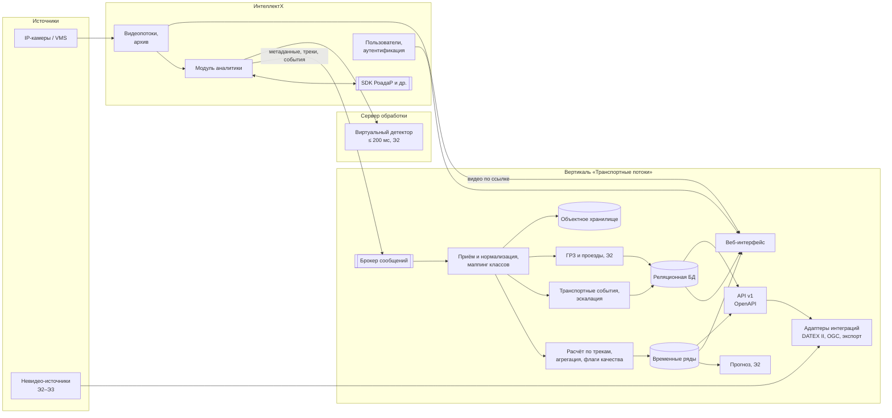

# Спецификация: вертикальное решение «Транспортные потоки» для ИнтеллектХ

| Атрибут | Значение |
|---|---|
| Продукт | Веб-ориентированное вертикальное решение для продукта ИнтеллектХ (ITV) по анализу транспортных потоков |
| Исходный документ | `Трафик фукциональные требования.docx` (автор: Andrey Khristoforov, ред. 3, 28.09.2026) |
| Версия спецификации | **0.4** (предложение аналитика) |
| Дата | 01.10.2026 |
| Основание изменений | Критическое ревью `Review/2026-10-01_v2.md` (CR-01 … CR-51) |
| Стадия продукта | Концепт |
| Статус | Черновик. Предложения, помеченные `[предложение]`, и допущения `[assumption]` требуют подтверждения — сводный перечень в разделе 24 |

**История изменений**

| Версия | Дата | Изменения |
|---|---|---|
| 0.1 | 30.09.2026 | Структурирование ТЗ, проверка, вопросы. Архив: `Archive/Traffic_Specification_v0.1.MD` |
| 0.2 | 01.10.2026 | Модель «платформа + SDK аналитики», базовый классификатор, профили SDK и регионов, интеграции, NFR, метрики. Архив: `Archive/Traffic_Specification_v0.2.MD` |
| 0.3 | 01.10.2026 | Закрыты вопросы к заказчику (ИБ, интерфейс, карта, хеширование, списки). Архив: `Archive/Traffic_Specification_v0.3.MD` |
| 0.4 | 01.10.2026 | По ревью v2: продуктовая рамка, сегменты и MVP; граница «ИнтеллектХ / вертикаль»; персоны и сценарии; реестр источников данных и качество данных; архитектура данных и варианты развёртывания; классы задержки; типовые интеграции и экспорт в инструменты моделирования; прогноз, холодный старт, объяснимость; профили нагрузки, RPO/RTO; экономика, KPI, риски; исправлены противоречия CR-43 … CR-48 |

**Легенда**

| Обозначение | Значение |
|---|---|
| `FR-XXX-NN`, `NFR-NN` | Функциональное / нефункциональное требование; `.M` — подпункт |
| Тип **ИХ** | Функция платформы ИнтеллектХ; вертикаль её использует |
| Тип **В** | Функция вертикали «Транспортные потоки» |
| Тип **SDK** | Выполняет SDK производителя аналитики; доступно, если заявлено в профиле SDK |
| Тип **В/SDK** | Значение берётся из SDK, если он его выдаёт; иначе вертикаль рассчитывает его по трекам SDK (раздел 10.2) |
| Этап **MVP / Э2 / Э3** | Первая поставка / второй этап / третий этап (раздел 1.5) `[предложение]` |
| Источник | `ТЗ N` — пункт ТЗ; `CR-NN` — замечание ревью v2; `0.3` — требование перенесено из версии 0.3 |
| `[предложение]` | Решение аналитика, требует согласования |
| `[assumption]` | Допущение о внешнем факте, требует проверки |

Если функция типа SDK недоступна для видеопотока, она скрыта в интерфейсе, а в отчётах вместо значения показывается «нет данных».

---

## 1. Продукт: проблема, ценность, MVP

### 1.1 Проблема клиента (CR-01)

| Сегмент | Проблема | Как решается сейчас `[assumption]` |
|---|---|---|
| Муниципалитет, ЦОДД | Нет непрерывных данных об интенсивности, составе и скорости потока; решения об изменении ОДД принимаются без измерения эффекта | Разовые натурные обследования, ручной подсчёт по видео, данные навигационных сервисов без детализации по классам и полосам |
| Оператор дорог | Позднее обнаружение инцидентов (ДТП, остановки, выпавший груз), особенно на магистралях и в тоннелях | Операторы видеонаблюдения смотрят камеры вручную; звонки участников движения |
| Диспетчерский центр | Перегрузка операторов видео; нет приоритизации событий и единого журнала обработки | Видеостены без автоматики, журналы в свободной форме |
| Девелопер, проектировщик | Для оценки транспортного воздействия нужны исходные данные (картограммы, интенсивности, корреспонденции) | Заказные обследования на 1–3 дня, дорого и не отражают сезонность |
| Логистика | Нет надёжных данных о времени въезда-выезда и простоях ТС на объектах | Ручной учёт, пропускные системы без аналитики |

### 1.2 Ценность и бизнес-метрики клиента (CR-02)

Метрики измеряются средствами продукта: сравнение периодов «до / после» (FR-ANL-04) на одинаковых типах дней.

| Метрика эффекта | Сегмент | Методика измерения |
|---|---|---|
| Снижение затрат на натурные обследования | Муниципалитет, девелопер | Стоимость эквивалентного ручного обследования минус стоимость продукта на точку учёта за год |
| Время от возникновения инцидента до его подтверждения оператором | Оператор дорог, диспетчерский центр | Медиана «начало события → статус „Подтверждено“» (FR-EVT-05) до и после внедрения |
| Средняя задержка ТС на подходе к перекрёстку | Муниципалитет, ЦОДД | По параметрам очереди (FR-FLW-08) до и после изменения ОДД или светофорного регулирования |
| Время в пути по контрольным маршрутам | Муниципалитет, ЦОДД | По FR-LPR-11 (Э2) |
| Доля событий, обработанных в пределах норматива | Диспетчерский центр | По журналу событий (FR-EVT-05, FR-EVT-06) |

Снижение числа ДТП и выбросов — долгосрочный эффект мер ОДД, а не продукта; продукт предоставляет данные для его оценки, но не обещает его напрямую.

### 1.3 Почему вертикальное решение (CR-03)

ИнтеллектХ — горизонтальная платформа видеонаблюдения и видеоаналитики `[assumption]`. Транспортная вертикаль добавляет то, чего в горизонтальной платформе нет:

1. транспортную модель данных: подходы, полосы, направления, точки учёта, участки дорожной сети;
2. расчёт параметров потока по отраслевым методикам (приведённая интенсивность, неравномерность, уровень обслуживания, очереди);
3. отраслевые отчёты и экспорт в инструменты транспортного моделирования;
4. интеграции со стандартами ИТС (DATEX II, NTCIP, OGC);
5. сценарии и роли транспортных служб: диспетчер ЦОДД, инженер ОДД, транспортный планировщик.

### 1.4 Сегменты и приоритет (CR-04)

| Приоритет | Сегмент | Обоснование `[предложение]` |
|---|---|---|
| 1 | Муниципалитет / ЦОДД | Функции ТЗ и SDK РоадаР ближе всего к этому сегменту: учёт, состав, скорость, события, отчёты |
| 1 | Оператор дорог / диспетчерский центр | События SDK РоадаР (ДТП, остановка, встречное движение, потерянный груз) закрывают основной сценарий |
| 2 | Девелопер, проектировщик | Нужны экспорт в инструменты моделирования и временные обследования (Э2) |
| 3 | Логистика | Нужны распознавание ГРЗ и учёт въезда-выезда — другой SDK (Э2–Э3) |

### 1.5 MVP и этапы (CR-51)

| Этап | Содержание `[предложение]` | Зависимости |
|---|---|---|
| **MVP** | SDK РоадаР; учёт интенсивности и состава по полосам и направлениям; скорость и V85; картограммы; занятость и очереди; уровень загрузки; события РоадаР с обработкой и эскалацией; дашборды, карта, отчёты, сравнение периодов; экспорт CSV/XLSX и в инструменты моделирования; базовая ИБ; профиль нагрузки S | Подтверждение границы ИнтеллектХ (раздел 4.1) |
| **Э2** | SDK распознавания ГРЗ, журнал проездов, списки контроля, время в пути, корреспонденции; SDK пешеходов; прогноз; отчёт по эффективности светофорных объектов; виртуальный детектор; DATEX II, OGC; погода и плановые события; push и мессенджеры; профиль нагрузки M | Выбор SDK ГРЗ и пешеходов |
| **Э3** | Нарушения ПДД (кроме событий РоадаР); невидео-источники (детекторы, GPS ОТ, GTFS); гибридное и облачное развёртывание; профиль нагрузки L; сертификация ФСТЭК по запросу | Доступность источников у заказчиков |

**Критерии успеха пилота MVP** `[предложение]`: 1 город, 10–30 точек учёта, 3 месяца эксплуатации; метрики SDK раздела 19.1 подтверждены на эталонной выборке заказчика; не менее 5 активных пользователей заказчика еженедельно; хотя бы одно решение по ОДД принято с использованием данных продукта.

### 1.6 Вне области продукта

- Вынесение постановлений об административных правонарушениях: фиксация нарушений и скорости — информационная; продукт и SDK не являются средствами измерений утверждённого типа (0.3).
- Собственное макро-, мезо- и микромоделирование транспорта: продукт поставляет данные для калибровки внешних моделей (FR-ANL-09) (CR-20).
- Адаптивное управление светофорами: продукт — источник данных для АСУДД и инструмент оценки работы светофорных объектов (CR-13).
- Данные операторов мобильной связи (дорогие, лицензионно ограниченные) `[предложение]`.
- Обработка видеофайлов, загружаемых пользователем (0.3).

## 2. Персоны и сценарии (CR-05, CR-36, CR-37, CR-38)

### 2.1 Персоны

| Персона | Роль в продукте | Ключевые задачи | Частота работы |
|---|---|---|---|
| Диспетчер ЦОДД / оператора дорог | Оператор | Реагировать на события, контролировать загрузку сети | Постоянно, посменно |
| Инженер-аналитик ОДД | Аналитик | Анализ интенсивности, картограммы, оценка мер ОДД «до / после» | Ежедневно |
| Транспортный планировщик / проектировщик | Аналитик | Выгрузка данных для моделей, корреспонденции | Под проект |
| Руководитель (ЦОДД, департамент транспорта) | Руководитель | KPI сети, тренды, отчёты для отчётности перед администрацией | Еженедельно |
| Администратор | Администратор | Точки учёта, сцены, маппинг классов, пользователи | По мере необходимости |

### 2.2 Сквозные сценарии

| ID | Сценарий | Персона | Шаги (кратко) | Функции | Этап |
|---|---|---|---|---|---|
| СЦ-01 | Реакция на инцидент | Диспетчер | Оповещение → карточка с видео → подтверждение или отклонение → передача ответственному → закрытие; при задержке — эскалация | FR-EVT-04 … 06 | MVP |
| СЦ-02 | Смена диспетчера | Диспетчер | Приём смены: открытые события, неисправные видеопотоки, загрузка сети; передача смены с комментарием | FR-EVT-06, FR-SRC-07, FR-ANL-02 | MVP |
| СЦ-03 | Оценка изменения ОДД | Инженер ОДД | Выбор точек и периодов «до / после» → сравнение интенсивности, скорости, очередей → отчёт | FR-ANL-04, FR-FLW | MVP |
| СЦ-04 | Обследование перекрёстка | Инженер ОДД, планировщик | Выбор перекрёстка и периода → картограмма по классам → приведённая интенсивность → выгрузка в Visum / Vissim / SUMO | FR-FLW-02, 04, FR-ANL-09 | MVP |
| СЦ-05 | Ежемесячный отчёт руководителю | Руководитель | Дашборд KPI → отчёт по расписанию на e-mail | FR-ANL-01, 06, 10 | MVP |
| СЦ-06 | Мобильный просмотр | Руководитель, диспетчер в поле | Карта загрузки, список событий, подтверждение события; видео — по запросу в пониженном качестве | NFR-10, FR-EVT-05 | MVP |
| СЦ-07 | Поиск ТС по ГРЗ | Оператор | Поиск по маске → маршрут на карте → выгрузка | FR-LPR-08, 09 | Э2 |

## 3. Термины и сокращения

| Термин | Определение |
|---|---|
| ИнтеллектХ (ИХ) | Платформа ITV: видеопотоки, архив, пользователи, модули аналитики с SDK, серверы обработки `[assumption]` |
| Вертикаль | Разрабатываемое веб-решение «Транспортные потоки» поверх ИХ |
| Точка учёта | Транспортный объект вертикали (перекрёсток, сечение дороги, въезд), связанный с одним или несколькими видеопотоками |
| Подход | Направление въезда на перекрёсток; содержит полосы |
| Видеопоток | Сущность ИХ: источник видео (IP-камера или поток внешней VMS) |
| Сервер обработки | Компьютер ИХ, на котором работают SDK |
| SDK аналитики | Библиотека или локальный сервис производителя: на входе кадры, на выходе аналитическая информация |
| Профиль SDK | Описание возможностей, параметров, метрик качества версии SDK |
| Базовый класс | Класс объекта вертикали, единый для всех SDK |
| Региональный профиль | Требования, зависящие от страны или региона внедрения |
| Сцена | Зоны, линии, полосы, стоп-линии и калибровка видеопотока |
| Трек | Последовательность положений объекта с уникальным ID |
| Проезд | Запись о прохождении ТС с ГРЗ через точку фиксации |
| Флаг качества | Признак полноты и достоверности агрегата (раздел 5.3) |
| Уровень обслуживания (LOS) | Качественная оценка условий движения (шкала настраивается) |
| GEH | Статистика сравнения интенсивностей, применяемая при калибровке транспортных моделей |
| DATEX II, NTCIP, OGC, GTFS | Стандарты обмена данными ИТС, контроллеров и детекторов, геоданных, расписаний ОТ |
| ТС, ГРЗ, СИМ, ДОПОГ, ОДД, АСУДД, ЦОДД, ОТ | Транспортное средство; гос. регистрационный знак; средство индивидуальной мобильности; перевозка опасных грузов; организация дорожного движения; автоматизированная система управления дорожным движением; центр организации дорожного движения; общественный транспорт |
| Интенсивность, V85, занятость, картограмма, матрица корреспонденций | См. версию 0.3, раздел 2 |

## 4. Архитектура

### 4.1 Граница «ИнтеллектХ / вертикаль» (CR-42, CR-43)

Интерпретация: «платформа», которой принадлежат видеопотоки и модуль аналитики с SDK, — это ИнтеллектХ; вертикаль — транспортное решение поверх неё. `[предложение]` — требует подтверждения владельцем ИХ (вопрос V-01).

| Функция | ИнтеллектХ | Вертикаль | Новая разработка в ИХ |
|---|---|---|---|
| Подключение камер и VMS, декодирование, видеоархив, просмотр | ✔ | — | — |
| Пользователи, аутентификация, базовые права | ✔ | Транспортные роли и права (FR-ACC) | — |
| Модуль аналитики, запуск SDK, лицензии SDK | ✔ | — | Профиль SDK, если отсутствует `[assumption]` |
| Сцена для SDK (зоны, линии) | ✔ | Транспортная привязка: подходы, номера полос, направления, связь с дорожной сетью | — |
| Детекция, классификация, события SDK | ✔ (через SDK) | — | — |
| Передача метаданных SDK наружу | — | Потребитель | Поток метаданных и треков в брокер сообщений, если отсутствует `[assumption]` |
| Маппинг классов, параметры потока, агрегация, флаги качества | — | ✔ | — |
| Журнал проездов, списки контроля, корреспонденции | — | ✔ (Э2) | — |
| Карточки транспортных событий, эскалация | Базовые тревоги ИХ | ✔ транспортная карточка и обработка | — |
| Дашборды, карта, отчёты, прогноз, экспорт | — | ✔ | — |
| Интеграции ИТС | — | ✔ | — |

Для автономной поставки без ИХ (если потребуется) функции колонки «ИнтеллектХ» обеспечиваются отдельным проектом; в этой версии спецификации автономная поставка не рассматривается.

### 4.2 Схема

### 4.3 Варианты развёртывания (CR-31)

| Вариант | Описание | Этап |
|---|---|---|
| Локальный (основной) | ИХ и вертикаль у заказчика, в т. ч. в закрытом контуре без интернета | MVP |
| Гибридный | Видео и SDK у заказчика (ИХ), вертикаль — в облаке или в центре данных интегратора; через канал передаются только метаданные | Э3 |
| Облачный | ИХ и вертикаль в облаке; камеры подключаются через защищённые каналы | Э3, по запросу |

На периферии (сервер обработки ИХ) остаются: декодирование, SDK, виртуальный детектор, буфер метаданных при потере связи (NFR-04). В центре — всё остальное.

### 4.4 Архитектура данных (CR-32)

| Поток / хранилище | Содержимое | Срок хранения по умолчанию `[предложение]` | Этап |
|---|---|---|---|
| Брокер сообщений (Kafka или аналог) | Метаданные SDK: объекты, треки, события, проезды; версия контракта в каждом сообщении | 72 ч (для повторной обработки) | MVP |
| Хранилище временных рядов | Агрегаты 1 / 5 / 15 / 60 мин и сутки с флагами качества | 5 лет | MVP |
| Сырые треки | Для пересчёта, тепловых карт, разбора | 14 суток | MVP |
| Реляционная БД | Конфигурация, точки учёта, маппинг, события, проезды, списки, журнал действий | По FR-ADM-02 | MVP |
| Объектное хранилище | Ключевые кадры событий, изображения ТС и ГРЗ | По FR-ADM-02 | MVP |
| Видеоархив | Остаётся в ИХ; вертикаль хранит ссылки «видеопоток + интервал» | По профилю хранения ИХ (NFR-07) | MVP |

Правила обработки потока:

- доставка «не менее одного раза»; идемпотентность по ключу «экземпляр SDK + ID сообщения» (CR-35);
- порядок — по метке времени кадра в пределах видеопотока;
- запоздавшие данные принимаются до 5 мин после окончания интервала агрегации; позже — пересчёт агрегата с отметкой в журнале `[предложение]`.

### 4.5 Классы задержки (CR-15)

| Класс | Норматив | Функции |
|---|---|---|
| Реальное время | ≤ 1 с | Виртуальный детектор (≤ 200 мс, на периферии); детекция событий в SDK |
| Близкое к реальному | ≤ 1 мин | Оповещение по спискам (≤ 2 с от момента проезда); карточка события (≤ 5 с); карта загрузки и дашборды реального времени (≤ 1 мин); обновление прогноза (каждые 5 мин) |
| Пакетная обработка | ≤ 15 мин / ≤ 1 ч | Агрегаты 15 мин доступны ≤ 2 мин после окончания интервала; суточные агрегаты и коэффициенты ≤ 1 ч после окончания суток; отчёты по расписанию ≤ 1 ч |

## 5. Источники данных

### 5.1 Реестр источников (CR-06, CR-10)

| Источник | Данные | Частота / задержка | Точность | Формат / протокол | Права и юрисдикция | Этап |
|---|---|---|---|---|---|---|
| Видео + SDK РоадаР | Объекты, треки, классы, события | Кадры 12–25 к/с; метаданные ≤ 1 с | Раздел 19.1 | Контракт SDK (раздел 8.1) | Видео — заказчика; метаданные — заказчика | MVP |
| Видео + SDK ГРЗ | Проезды, ГРЗ, атрибуты ТС | ≤ 1 с | Раздел 19.1 | Контракт SDK | ПДн — по региональному профилю | Э2 |
| Видео + SDK пешеходов | Пешеходы, велосипедисты, СИМ | ≤ 1 с | Раздел 19.1 | Контракт SDK | Видео — заказчика | Э2 |
| Погода | Осадки, температура, видимость | 15–60 мин | По данным поставщика | REST API метеосервиса | Лицензия поставщика | Э2 |
| Плановые события | Ремонты, перекрытия, мероприятия | По факту | — | Ручной ввод, DATEX II | Заказчика | Э2 |
| Состояние светофоров | Фазы, циклы | ≤ 1 с | — | Протокол контроллера (по проекту) | Заказчика | Э2 |
| Детекторы транспорта (петли, радары) | Интенсивность, скорость, занятость | 20 с – 5 мин | По паспорту детектора | NTCIP 1209 или протокол производителя | Заказчика | Э3 |
| GPS/ГЛОНАСС ОТ | Положение, скорость | 10–30 с | 5–15 м `[assumption]` | GTFS-Realtime, протокол РНИС | Оператора ОТ, договор | Э3 |
| Расписания ОТ | Маршруты, расписания | Ежедневно | — | GTFS | Оператора ОТ | Э3 |
| Данные операторов связи | — | — | — | — | Вне области (1.6) | — |

**Владение данными (CR-10).** Видео, метаданные и производные данные принадлежат заказчику. Передача выборок производителю SDK для дообучения — только с письменного согласия заказчика и с маскированием лиц `[предложение]`.

### 5.2 Требования к видеопотоку (CR-07)

| Назначение | Разрешение | Частота кадров | Прочее | Основание |
|---|---|---|---|---|
| Учёт и события | ≥ 1280×720 | ≥ 12 к/с | Камера над полосами или сбоку, без перекрытия полос | `[assumption]`, уточняется профилем SDK |
| Распознавание ГРЗ | ≥ 1920×1080 | ≥ 25 к/с | Ширина ГРЗ в кадре — по профилю SDK; ИК-подсветка ночью | `[assumption]`, уточняется профилем SDK |

Профиль SDK может ужесточать требования (FR-SDK-03); платформа предупреждает администратора при назначении SDK на видеопоток с параметрами ниже минимальных.

### 5.3 Качество данных и деградация источника (CR-08, CR-28)

| ID | Тип | Этап | Требование | Источник | Критерий приёмки |
|---|---|---|---|---|---|
| FR-DQ-01 | В | MVP | Каждый агрегат хранит **флаг качества**: «полный» (данные за ≥ 95 % интервала), «неполный» (50–95 %), «недостоверный» (< 50 % или неисправность видеопотока), «восстановлен» (заполнен по правилу FR-DQ-02). | CR-08 | Флаг виден в дашбордах, отчётах и API. |
| FR-DQ-02 | В | MVP | Заполнение пропусков — только по явному выбору пользователя в отчёте: по исторической норме для того же типа дня и интервала. По умолчанию пропуски показываются как пропуски. | CR-08 | Отчёт с заполнением помечает восстановленные значения. |
| FR-DQ-03 | В | MVP | Деградация видеопотока (данные от ИХ о потере сигнала, падении FPS; от SDK — о засветке, смещении камеры) переводит агрегаты в «недостоверный» и формирует событие «Неисправность видеопотока». | CR-08, 0.3 FR-SRC-07 | |
| FR-DQ-04 | В | Э2 | Прогноз и коэффициенты неравномерности не используют агрегаты с флагом «недостоверный». | CR-08 | |
| FR-DQ-05 | В | MVP | Метрики качества данных по точке учёта и системе: полнота агрегатов за сутки, задержка поступления, доля видеопотоков без данных. Отображаются в отчёте о работоспособности (FR-ANL-05.5). | CR-28 | Целевые значения — раздел 19.3. |

### 5.4 Приватность (CR-09)

| ID | Тип | Этап | Требование | Источник |
|---|---|---|---|---|
| FR-PRV-01 | В | MVP | Для каждого регионального профиля фиксируются правовое основание обработки, сроки хранения по видам данных, режим отображения ГРЗ. | CR-09, 0.3 FR-ACC-04 |
| FR-PRV-02 | ИХ/SDK | Э2 | Маскирование лиц и ГРЗ при выгрузке видео и изображений за пределы системы и при передаче выборок производителю SDK. | CR-09, CR-10 |
| FR-PRV-03 | В | Э2 | Для внедрений в ЕС в состав проекта входит оценка воздействия на защиту данных (GDPR, ст. 35). | CR-09 |
| FR-PRV-04 | В | MVP | Сырые треки не содержат ГРЗ; связь трека с ГРЗ хранится только в проезде. | CR-09 |

## 6. Роли и доступ (FR-ACC)

| ID | Тип | Этап | Требование | Источник | Критерий приёмки |
|---|---|---|---|---|---|
| FR-ACC-01 | В | MVP | Транспортные роли: Администратор, Оператор (диспетчер), Аналитик, **Руководитель** (сводные KPI и отчёты), Наблюдатель. | 0.3, CR-37 | |
| FR-ACC-02 | В | MVP | Настраиваемые роли; права ограничиваются по группам точек учёта. | 0.3 | |
| FR-ACC-03 | В | Э2 | Отдельные права: просмотр ГРЗ в открытом виде, поиск по ГРЗ, ведение списков контроля, режим «исследование» (FR-LPR-11.1), выгрузка данных. | 0.3 | Без права «Просмотр ГРЗ» ГРЗ маскирован. |
| FR-ACC-04 | В | Э2 | Режим отображения ГРЗ по умолчанию — из регионального профиля (РФ — по праву; ЕС — маскирование). | 0.3 | |
| FR-ACC-05 | ИХ | MVP | Пользователи и аутентификация — средствами ИХ (локальные учётные записи ИХ); вертикаль хранит только транспортные роли и права пользователя ИХ. | CR-43, 0.3 | Пользователь входит в вертикаль под учётной записью ИХ без отдельного пароля. |

## 7. Видеопотоки, точки учёта и сцена (FR-SRC)

| ID | Тип | Этап | Требование | Источник | Критерий приёмки |
|---|---|---|---|---|---|
| FR-SRC-01 | ИХ | MVP | Добавление, редактирование, удаление и группировка видеопотоков; источники — IP-камеры (RTSP/ONVIF) и внешние VMS. | ТЗ 1.1, 0.3 | |
| FR-SRC-01.1 | В | MVP | **Точка учёта** — транспортный объект (перекрёсток, сечение, въезд) с адресом, координатами, привязкой к дорожной сети и одним или несколькими видеопотоками ИХ. | ТЗ 1.1, CR-42 | Точка учёта отображается на карте; данные агрегируются по точке. |
| FR-SRC-01.2 | ИХ | MVP | Назначение на видеопоток одного или нескольких SDK; кадры декодируются один раз. | 0.3 | |
| FR-SRC-02 | ИХ | MVP | Редактор сцены: линии с направлением, зоны детекции и въезда-выезда, полосы, стоп-линии, зоны накопления очереди, пешеходные переходы, зоны исключения. Сцена передаётся в SDK. | ТЗ 1.2, 0.3 | |
| FR-SRC-02.1 | В | MVP | Транспортная привязка элементов сцены: подход перекрёстка, номер полосы, направление движения (прямо, налево, направо, разворот), участок дорожной сети. | ТЗ 1.2, CR-42 | Картограмма строится без ручной настройки после привязки. |
| FR-SRC-03 | ИХ/В | MVP | Калибровка сцены по известным расстояниям; используется SDK и расчётом по трекам (10.2). | ТЗ 1.3 | |
| FR-SRC-04 | ИХ | MVP | Видеоархив; срок хранения — по профилю хранения (NFR-07). | 0.3, CR-30 | |
| FR-SRC-05 | ИХ | MVP | Просмотр архива с наложением результатов аналитики. | 0.3 | |
| FR-SRC-06 | ИХ/В | MVP | Видеофрагмент события или проезда — ссылка на интервал архива ИХ (по умолчанию 5 с до и 5 с после); при удалении архива ключевые кадры сохраняются в объектном хранилище вертикали. | 0.3 | |
| FR-SRC-07 | ИХ/SDK | MVP | Состояние видеопотока (потеря сигнала, FPS — ИХ; засветка, загрязнение, смещение — SDK) передаётся в вертикаль; используется в FR-DQ-03. | ТЗ 7.5, 0.3 | |

## 8. Модуль аналитики и профили SDK (FR-SDK)

| ID | Тип | Этап | Требование | Источник | Критерий приёмки |
|---|---|---|---|---|---|
| FR-SDK-01 | ИХ | MVP | Модуль аналитики передаёт в SDK кадры и сцену, получает результаты и публикует их в брокер сообщений вертикали по контракту 8.1. | 0.3, CR-32 | |
| FR-SDK-02 | ИХ | MVP | SDK исполняется как библиотека или локальный сервис. | 0.3 | |
| FR-SDK-03 | В | MVP | Профиль SDK: производитель, версия, способ исполнения, минимальные требования к видеопотоку, элементы сцены, классы и признаки, типы событий, параметры потока, модель лицензирования, рекомендуемые конфигурации оборудования (по замерам), фактические метрики качества. | 0.3 | Структура — приложение A. |
| FR-SDK-04 | ИХ/В | MVP | Подключение SDK нового производителя — адаптер в ИХ и профиль в вертикали, без изменения ядра вертикали. | 0.3 | |
| FR-SDK-05 | ИХ/В | MVP | Новая версия SDK (по графику производителя или по запросу на доработку) устанавливается в ИХ; версия SDK сохраняется в каждом результате; отчёты за период со сменой версии помечаются. | ТЗ 4.5, 0.3 | |
| FR-SDK-06 | ИХ | MVP | Учёт лицензий SDK (РоадаР — на видеопоток). | 0.3 | |
| FR-SDK-07 | В | MVP | Допуск SDK: испытание на эталонной выборке по методике 19.4, запись фактических метрик в профиль. | 0.3, CR-49 | |

### 8.1 Контракт данных SDK → вертикаль (CR-35)

- Контракт версионируется (`contract_version` в каждом сообщении, семантическое версионирование); несовместимые изменения — только с новой мажорной версией и периодом параллельной поддержки.
- Типы сообщений: объект, трек (завершённый), событие (начало / обновление / окончание), проезд с ГРЗ, метрики потока, состояние SDK и видеопотока.
- Обязательные поля каждого сообщения: ID сообщения, экземпляр SDK, видеопоток, метка времени кадра (мс, UTC), версия SDK, версия контракта.
- Состав полей по типам — как в версии 0.3, раздел 6.1.

## 9. Детекция и сопровождение (FR-DET)

| ID | Тип | Этап | Требование | Источник | Критерий приёмки |
|---|---|---|---|---|---|
| FR-DET-01 | SDK | MVP | Обнаружение ТС базовых классов; перечень — по профилю SDK. | ТЗ 2.1 | Метрика «Полнота детекции». |
| FR-DET-01.1 | SDK | Э2 | Обнаружение пешеходов, велосипедистов, СИМ — отдельным SDK. | ТЗ 2.1, CR-50 | |
| FR-DET-01.2 | SDK | MVP / Э2 | Обнаружение посторонних предметов и выпавшего груза (РоадаР — MVP); животных, дыма и пламени (Э2, другой SDK). | 0.3 | |
| FR-DET-02 | SDK | MVP | Трекинг с уникальным ID, траекторией, исключением повторного учёта, сохранением при кратковременном перекрытии. | ТЗ 2.2, 2.3 | Метрика «Устойчивость трекинга». |

## 10. Параметры транспортного потока (FR-FLW)

### 10.1 Требования

| ID | Тип | Этап | Требование | Источник | Критерий приёмки |
|---|---|---|---|---|---|
| FR-FLW-01 | В/SDK | MVP | Интенсивность по линиям и зонам, полосам, направлениям, базовым классам. | ТЗ 3.1 | Точность подсчёта и GEH (19.1). |
| FR-FLW-01.1 | В | MVP | Агрегация 1, 5, 15, 60 мин, сутки, произвольный период; по местному времени точки учёта. | ТЗ 3.1 | |
| FR-FLW-02 | В/SDK | MVP | Картограммы по подходам и направлениям с разбивкой по классам. | ТЗ 3.2 | |
| FR-FLW-03 | В/SDK | MVP | Матрица корреспонденций в пределах сцены. | ТЗ 3.3 | |
| FR-FLW-04 | В | MVP | Приведённая интенсивность; методика и коэффициенты настраиваются; шаблон по ОДМ 218.2.032-2013. | ТЗ 3.4, 0.3 | |
| FR-FLW-05 | В | MVP | Пиковый час, коэффициенты суточной и недельной неравномерности (с учётом холодного старта, 14.3). | ТЗ 3.5, CR-22 | |
| FR-FLW-06 | В/SDK | MVP | Мгновенная и средняя скорость, V85; число ТС выше порога (информационно). | ТЗ 3.6 | Погрешность скорости (19.1). |
| FR-FLW-07 | В/SDK | MVP | Занятость, интервалы, плотность. | ТЗ 3.7 | |
| FR-FLW-08 | В/SDK | MVP | Очередь: длина (м, ТС), время ожидания, число остановок, **средняя задержка на подходе**. | ТЗ 3.8, CR-02 | |
| FR-FLW-09 | В/SDK | MVP | Уровень загрузки по полосе и участку; шкала настраивается в региональном профиле: 3 уровня по умолчанию или A–F (HCM; ОДМ 218.2.020-2012 — проверить редакцию). | ТЗ 3.9, CR-18 | |
| FR-FLW-10 | В/SDK | Э2 | Учёт пешеходов на переходах, велосипедистов, СИМ с направлением. | ТЗ 3.10, CR-50 | Требует SDK пешеходов. |
| FR-FLW-11 | SDK/ИХ | Э2 | Виртуальный детектор для контроллера светофорного объекта: сигнал формируется **на сервере обработки** без участия центра вертикали, задержка ≤ 200 мс от появления ТС в зоне на кадре. Протокол — по проекту. | ТЗ 3.11, CR-33 | Замер на стенде с контроллером. |
| FR-FLW-12 | В | Э2 | Отчёт об эффективности светофорного объекта: задержка, очередь и число остановок по подходам, коэффициент загрузки; при наличии состояния сигналов — по фазам. | CR-13 | |

### 10.2 Расчёт параметров по трекам (CR-25)

Применяется, если SDK не выдаёт параметр сам (тип В/SDK). Источник значения (SDK / вертикаль) сохраняется в агрегате.

| Параметр | Метод `[предложение]` | Требования к трекам |
|---|---|---|
| Интенсивность, картограмма, корреспонденции | Пересечение трека с линией в заданном направлении; направление на перекрёстке — по паре «зона въезда → зона выезда» | Трек проходит через обе зоны без смены ID |
| Скорость | Расстояние между двумя линиями в метрах (калибровка) / время прохождения; V85 — по распределению за интервал | Калибровка задана; ≥ 5 положений трека между линиями |
| Занятость | Доля времени, когда в зоне есть хотя бы один трек | Частота метаданных ≥ 5 Гц |
| Очередь | ТС со скоростью < 5 км/ч в зоне накопления; длина — от стоп-линии до последнего такого ТС; задержка — разница фактического и свободного времени проезда | Калибровка, зона накопления |
| Плотность | Число ТС в зоне / длина зоны в км | Калибровка |

Связка «SDK + вертикаль» проходит допуск по тем же метрикам, что и SDK (FR-SDK-07).

## 11. Классификация ТС (FR-CLS)

Двухуровневый классификатор: базовый класс (единый для всех SDK) → подкласс производителя (из профиля SDK); третий уровень — класс методики учёта (FR-CLS-02). Критерии по массе не используются. Описания классов — версия 0.3, раздел 9.1; маппинг РоадаР — приложение A.3.

| Код | Базовый класс | Группа |
|---|---|---|
| BC-01 … BC-08 | Легковой; Лёгкий коммерческий; Грузовой; Автопоезд; Автобус; Городской электротранспорт; Мототехника; Спецтехника | ТС |
| BC-09 … BC-11 | Велосипед; СИМ; Пешеход | Прочие участники движения (Э2) |
| BC-99 | Не классифицировано | — |

| ID | Тип | Этап | Требование | Источник |
|---|---|---|---|---|
| FR-CLS-01 | SDK | MVP | Класс определяет SDK; вертикаль сопоставляет его с базовым классом. | ТЗ 4.1 |
| FR-CLS-02 | В | MVP | Справочник маппинга ведёт администратор; немаппированный подкласс → BC-99 с оповещением; смешанные подклассы помечаются «неоднозначно». | ТЗ 4.2 |
| FR-CLS-03 | SDK | MVP / Э2 | Признаки: прицеп, число осей, спецтранспорт, маячки, маршрутный, такси, ДОПОГ — по профилю SDK. | ТЗ 4.3 |
| FR-CLS-04 | SDK | Э2 | Атрибуты: цвет (целевое ≥ 10), тип кузова, марка, модель. | ТЗ 4.4 |
| FR-CLS-05 | SDK | — | Дообучение — производитель SDK (с учётом 5.1, владение данными). | ТЗ 4.5 |

## 12. ГРЗ и журнал проездов (FR-LPR) — этап Э2

| ID | Тип | Требование | Источник | Критерий приёмки |
|---|---|---|---|---|
| FR-LPR-01 … 05 | SDK | Распознавание ГРЗ РФ и иностранных (перечень — региональный профиль), до 200 км/ч (целевое), несколько ГРЗ в кадре, ГРЗ прицепа. | ТЗ 5.1 … 5.5 | Метрики ГРЗ (19.1). |
| FR-LPR-06 | В | Журнал проездов (поля — версия 0.3, FR-LPR-06). | ТЗ 5.6 | |
| FR-LPR-07 | В | Списки контроля: число не ограничено; загрузка вручную, CSV/XLSX, API; нечёткое совпадение (целевой допуск 1 символ). | ТЗ 5.7 | |
| FR-LPR-07.3 | В/SDK | Оповещение оператора **не позднее 2 с с момента проезда** (метка времени кадра). Бюджет: SDK ≤ 1 с, вертикаль ≤ 1 с `[предложение]`. | ТЗ 5.7, CR-44 | Замер от метки кадра до отображения оповещения. |
| FR-LPR-08 | В | Поиск по журналу по критериям и маске; выгрузка XLSX/PDF; каждый поиск по ГРЗ — в журнал действий. | ТЗ 5.8 | ≤ 5 с за 30 суток (19.2). |
| FR-LPR-09, 10 | В | Маршрут ТС на карте; средняя скорость между точками фиксации. | ТЗ 5.9, 5.10 | |
| FR-LPR-11 | В | Матрицы корреспонденций и время в пути по обезличенным ГРЗ. Соль хеша меняется раз в сутки в ночной минимум (по умолчанию 03:00 местного времени); в течение **окна перекрытия** (по умолчанию 2 ч, не меньше максимального времени в пути по маршрутам) сопоставление ведётся по хешам обеих солей. Обезличенные проезды хранятся настраиваемый срок; надолго — только агрегированные матрицы. | ТЗ 5.11, 0.3, CR-46 | Поездка, начатая в 02:30 и законченная в 03:20, учитывается. |
| FR-LPR-11.1 | В | Режим «исследование» для многодневных обследований: отдельная соль на срок исследования (до 90 суток), требует права, фиксируется в журнале действий. | CR-46 | |
| FR-LPR-12 | В | Контроль въезда в зоны с учётом класса, признаков и списков разрешений. | ТЗ 5.12 | |
| FR-LPR-13 | В | Аномалии: «двойники», несоответствие марки (при наличии источника сведений, CR-11), многократные проезды, совместное движение, нечитаемый ГРЗ. Каждая аномалия хранит объяснение: пары проездов, расчёт скорости, пороги. | ТЗ 5.13, CR-24 | |

## 13. События и инциденты (FR-EVT)

| ID | Тип | Этап | Требование | Источник | Критерий приёмки |
|---|---|---|---|---|---|
| FR-EVT-01 | SDK, В/SDK | MVP | Базовые типы событий РоадаР: остановка ТС, ДТП, затор, встречное направление, потерянный груз, падение средней скорости, уплотнение потока, превышение скорости. Перечень расширяемый. | ТЗ 6.1, 0.3 | Метрики событий (19.1). |
| FR-EVT-01.1 | SDK | Э2 | Пешеход или животное на проезжей части; дым и пламя — другой SDK. | ТЗ 6.1 | |
| FR-EVT-02 | SDK | MVP / Э3 | Нарушения ПДД (информационно): остановка в запрещённом месте, встречное направление — MVP (РоадаР); остальные пункты ТЗ 6.2 — Э3, другой SDK. | ТЗ 6.2 | |
| FR-EVT-03 | В | MVP | Настройка по типу события: зоны, расписание, пороги, минимальная длительность, приоритет, получатели. | ТЗ 6.3 | |
| FR-EVT-04 | В | MVP | Карточка события: тип, время, точка учёта, связанные ТС, ключевые кадры, видеофрагмент (ссылка на архив ИХ), статус, источник (SDK, версия), **объяснение**: детектор, сработавшие пороги, длительность. | ТЗ 6.4, CR-24 | ≤ 5 с от события в кадре. |
| FR-EVT-05 | В | MVP | Обработка: подтверждение, отклонение как ложного, комментарий, передача ответственному. | ТЗ 6.5 | |
| FR-EVT-06 | В | MVP | **Эскалация**: если событие не принято за N мин (по приоритету, по умолчанию 2 / 5 / 15 мин), оповещается следующий уровень; дежурные смены с приёмом-передачей смены (СЦ-02). | CR-17 | Непринятое событие эскалируется по правилу. |
| FR-EVT-07 | В | MVP / Э2 | Каналы оповещения: интерфейс и e-mail — MVP; веб-push, SMS и мессенджеры через адаптеры интеграций — Э2. | CR-17 | |

Жизненный цикл события — как в версии 0.3, раздел 11, плюс переход «Новое → Эскалировано → Передано» по FR-EVT-06.

## 14. Аналитика, прогноз и отчётность (FR-ANL)

### 14.1 Требования

| ID | Тип | Этап | Требование | Источник | Критерий приёмки |
|---|---|---|---|---|---|
| FR-ANL-01 | В | MVP | Дашборды реального времени и исторические: интенсивность, скорость, занятость, состав, очереди, события, флаги качества. | ТЗ 7.1 | |
| FR-ANL-02 | В | MVP | Карта: точки учёта, уровень загрузки, активные события, маршруты ТС (Э2). Подложка подключаемая (OSM по умолчанию), работа в закрытом контуре через локальный тайл-сервер. | ТЗ 7.2, 0.3 | |
| FR-ANL-03 | В | MVP | Тепловые карты траекторий и остановок (по сырым трекам за срок их хранения, далее — по агрегированной сетке). | ТЗ 7.3 | |
| FR-ANL-04 | В | MVP | Сравнение двух периодов с абсолютными и относительными изменениями; выбор сопоставимых типов дней. | ТЗ 7.4, CR-02 | |
| FR-ANL-05 | В | MVP | Отчёты: интенсивность и состав; картограммы; скоростной режим; события; работоспособность точек учёта и качество данных (FR-DQ-05). | ТЗ 7.5 | |
| FR-ANL-06 | В | MVP | Выгрузка XLSX, CSV, PDF; формирование по расписанию с рассылкой по e-mail. | ТЗ 7.6 | |
| FR-ANL-07 | В | Э2 | Прогноз интенсивности и уровня загрузки на горизонте до 60 мин (раздел 14.2). | ТЗ 7.7, CR-19 | Превосходит базовую линию (19.2). |
| FR-ANL-08 | В | Э2 | Учёт погоды и плановых событий как факторов прогноза и как фильтров при сравнении периодов. | CR-06, CR-19 | |
| FR-ANL-09 | В | MVP | **Экспорт для транспортного моделирования**: картограммы, интенсивности по точкам учёта и интервалам, матрицы корреспонденций — в форматах импорта PTV Visum / Vissim, SUMO, Aimsun (конкретные форматы — по проекту) и в CSV-шаблоне вертикали. | CR-12, CR-20 | Выгрузка импортируется в целевой инструмент без ручного преобразования. |
| FR-ANL-10 | В | MVP | Представление «Руководитель»: KPI сети (раздел 20.1), тренды, сводка событий. | CR-37 | |

### 14.2 Прогноз (CR-19, CR-24)

- **Базовая линия** — историческое среднее для того же типа дня и 15-минутного интервала по точке учёта.
- **Модель** `[предложение]` — градиентный бустинг по признакам: время, тип дня, недавние значения точки учёта и соседних точек, погода и плановые события (FR-ANL-08). Выбор модели — по результатам сравнения на исторических данных пилота.
- Модель в эксплуатацию допускается, только если она лучше базовой линии по MAPE не менее чем на 10 % относительно; иначе показывается базовая линия.
- Для каждого прогноза сохраняются версия модели и вклад основных признаков (объяснимость).

### 14.3 Холодный старт (CR-22)

| Функция | Минимум истории `[предложение]` | До накопления |
|---|---|---|
| Суточная неравномерность, пиковый час | 7 суток | Показывается с пометкой «предварительно» |
| Недельная неравномерность | 4 недели | Не рассчитывается |
| Прогноз | 4 недели (модель), 1 неделя (базовая линия) | Прогноз не показывается |
| Заполнение пропусков (FR-DQ-02) | 2 недели для того же типа дня | Недоступно |

## 15. Администрирование и хранение (FR-ADM)

| ID | Тип | Этап | Требование | Источник |
|---|---|---|---|---|
| FR-ADM-01 | В | MVP | Журнал действий пользователей вертикали (в т. ч. поиск по ГРЗ, изменения списков, маппинга, настроек). | ТЗ 8.1 |
| FR-ADM-02 | В | MVP | Сроки хранения по видам данных (раздел 4.4) с автоматическим удалением. | ТЗ 8.2 |
| FR-ADM-03 | В | Э2 | По истечении срока запись проезда удаляется целиком, **кроме проездов, связанных с событиями в статусе «Подтверждено»**: они хранятся по сроку хранения событий. После удаления проезда в карточке события остаются базовый класс и время, ГРЗ — нет. | 0.3, CR-45 |

## 16. Региональные профили (FR-REG)

Как в версии 0.3 (FR-REG-01 … 03): метрики, страны ГРЗ, методика, режим ГРЗ, сроки хранения, требования ИБ, часовой пояс, единицы, язык. Дополнения: шкала уровня загрузки (FR-FLW-09), правовое основание обработки (FR-PRV-01). Первый профиль — Россия.

## 17. Интеграции и API (FR-INT)

| ID | Тип | Этап | Требование | Источник | Критерий приёмки |
|---|---|---|---|---|---|
| FR-INT-01 | В | MVP | **API v1** вертикали: контракт в OpenAPI 3.x; версия в пути (`/api/v1`); семантическое версионирование; предыдущая мажорная версия поддерживается не менее 12 месяцев после выхода новой `[предложение]`; аутентификация внешних систем — OAuth2 (client credentials); ограничение частоты запросов. | CR-34 | Описание API публикуется вместе с релизом. |
| FR-INT-02 | В | MVP | Операции API: чтение агрегатов, событий, точек учёта; подписка на события (webhook); загрузка списков контроля (Э2). | 0.3 | |
| FR-INT-03 | В | MVP | Механизм адаптеров интеграций; нетиповые интеграции — по запросу, протокол определяется при постановке задачи. | 0.3 | |
| FR-INT-04 | В | Э2 | **Типовые интеграции**: публикация событий и данных о движении по DATEX II (EN 16157); слои точек учёта, загрузки и событий по OGC WMS / WFS; выгрузка в BI (представления БД, CSV по расписанию). | CR-16 | |
| FR-INT-05 | В | Э2 | Получение состояния светофорных объектов от контроллеров и передача виртуального детектора — по протоколу контроллера заказчика; при поддержке — NTCIP 1202. | CR-16, ТЗ 3.11, 6.2 | |
| FR-INT-06 | В | Э3 | Приём данных невидео-детекторов (NTCIP 1209 или протокол производителя), GPS ОТ (GTFS-Realtime, РНИС), расписаний (GTFS). | CR-06 | |

## 18. Нефункциональные требования (NFR)

### 18.1 Профили нагрузки (CR-26, CR-48)

| Профиль | Видеопотоков | Точек учёта | Проездов с ГРЗ в сутки | Событий в сутки | Пользователей одновременно | Этап `[предложение]` |
|---|---|---|---|---|---|---|
| S | до 50 | до 30 | до 0,5 млн | до 2 000 | до 20 | MVP |
| M | до 500 | до 300 | до 5 млн | до 20 000 | до 100 | Э2 |
| L | до 5 000 | до 3 000 | до 50 млн | до 200 000 | до 500 | Э3 |

Все NFR проверяются на нагрузочном стенде для профиля текущего этапа. Списки контроля: S — 100 тыс., M — 1 млн, L — 10 млн записей без нарушения FR-LPR-07.3.

### 18.2 Требования

| ID | Требование | Источник |
|---|---|---|
| NFR-01 | Количество видеопотоков и серверов обработки архитектурно не ограничено; проверяемые значения — по профилям 18.1. | 0.3, CR-48 |
| NFR-02 | Горизонтальное масштабирование серверов обработки (ИХ) и сервисов вертикали (приём, расчёт, API); хранилища — с репликацией для профилей M и L. | 0.3, CR-27 |
| NFR-03 | Автоматическое перераспределение видеопотоков при отказе сервера обработки (≤ 60 с). | 0.3 |
| NFR-04 | Буфер метаданных на сервере обработки при потере связи с центром: глубина настраивается, **минимум 24 ч** для рекомендуемых конфигураций; потери данных в пределах буфера — 0. | 0.3, CR-47 |
| NFR-05 | Синхронизация времени серверов (NTP), расхождение ≤ 10 мс. | 0.3 |
| NFR-06 | Рекомендуемые конфигурации серверов — по замерам нагрузки SDK; публикуются в профиле SDK. | 0.3 |
| NFR-07 | **Профили хранения видеоархива**: полный архив; только интервалы событий; полный архив в пониженном разрешении. Объём рассчитывается по битрейту и сроку (пример: 4 Мбит/с ≈ 43 ГБ в сутки, ≈ 1,3 ТБ за 30 суток на видеопоток). | 0.3, CR-30 |
| NFR-08 | **Доступность**: оперативный контур (события, оповещения, карта) — 99,9 % для M и L, 99,5 % для S; аналитический контур (отчёты, прогноз, экспорт) — 99,5 %. | CR-27 |
| NFR-09 | **RPO / RTO**: конфигурация и события — RPO ≤ 15 мин, RTO ≤ 1 ч; агрегаты — RPO ≤ 1 ч (с досчётом из брокера и буфера); резервное копирование ежесуточно с хранением 30 суток. | CR-27 |
| NFR-10 | **ИБ**: TLS для всех соединений; пароли — в ИХ; журнал действий; хранение ПДн по региональному профилю. Для РФ целевой уровень защищённости ПДн типового внедрения — УЗ-3 по ПП РФ № 1119 с мерами по приказу ФСТЭК № 21 `[assumption — подтвердить с юристом и ИБ]`; архитектура допускает использование сертифицированных средств защиты; сертификация продукта ФСТЭК — по запросу (Э3). | 0.3, CR-29 |
| NFR-11 | Интерфейс — веб-приложение (актуальные версии распространённых браузеров), адаптивная вёрстка; на мобильных устройствах доступны СЦ-06; видео — в пониженном качестве по запросу. | 0.3, CR-38 |

## 19. Метрики качества и испытания

### 19.1 Метрики SDK и связки «SDK + вертикаль»

Базовые значения из версии 0.3 (раздел 18.1) сохраняются: подсчёт ≥ 95 / 90 %, полнота детекции ≥ 97 / 93 %, трекинг ≥ 95 / 90 %, базовые классы ≥ 90 / 85 %, подклассы ≥ 80 / 75 %, скорость ±5 км/ч, ГРЗ ≥ 95 / 90 % и ≥ 90 / 85 %, события ≥ 90 / 80 %, ложные ≤ 5 / 10 в сутки на видеопоток (день / ночь и сложная погода). Дополнение:

| Метрика | Определение | Целевое значение | Источник |
|---|---|---|---|
| GEH часовых интенсивностей | GEH = √(2(M − C)² / (M + C)), M — значение вертикали, C — эталон | GEH < 5 для ≥ 85 % часовых интервалов по точке учёта | CR-21 (DMRB / TAG M3.1) |
| RMSE и MAPE скорости | По ТС и по средним за 15 мин | MAPE ≤ 10 % средних за 15 мин `[предложение]` | CR-21 |

### 19.2 Метрики вертикали

Задержки (раздел 4.5), поиск ≤ 5 с за 30 суток, перераспределение ≤ 60 с, доступность и RPO/RTO (NFR-08, NFR-09). Прогноз: MAPE ≤ 15 % (15 мин) и ≤ 25 % (60 мин) **и** лучше базовой линии не менее чем на 10 % относительно.

### 19.3 Метрики качества данных (CR-28)

| Метрика | Целевое значение `[предложение]` |
|---|---|
| Полнота 15-минутных агрегатов за сутки по системе | ≥ 98 % |
| Доля точек учёта без данных более 1 ч | ≤ 2 % |
| Задержка доступности 15-минутного агрегата | ≤ 2 мин после окончания интервала |

### 19.4 Методика испытаний (CR-23, CR-49)

1. **Подсчёт и классификация**: не менее 1 000 ТС на каждое сочетание «тип сцены × условие» (день, ночь, осадки); это даёт оценку точности 95 % с погрешностью около ±1,4 п. п. при доверительной вероятности 95 % `[предложение]`.
2. **Редкие события** (ДТП, выпавший груз, встречное движение, остановка): не менее 30 случаев на тип из архивов заказчиков и постановочных сцен; ложные срабатывания — по непрерывной записи не менее 7 суток на 3 видеопотоках.
3. **Скорость**: заезды эталонного ТС с GPS-логгером (не менее 30 проездов на точку) или поверенный радар.
4. **Связка «SDK + вертикаль»** проверяется на тех же выборках для параметров типа В/SDK.
5. Результаты — в профиле SDK с датой, версиями SDK и вертикали, регионом.

## 20. Метрики успеха продукта и экономика

### 20.1 KPI продукта (CR-41)

| KPI | Определение | Цель первого года `[предложение]` |
|---|---|---|
| Внедрение | Заказчики в эксплуатации / видеопотоки под вертикалью | Подтвердить с владельцем продукта |
| Активность | Доля пользователей заказчика, работающих еженедельно | ≥ 50 % |
| Оперативность | Доля событий, принятых в норматив (FR-EVT-06) | ≥ 90 % |
| Точность в эксплуатации | Доля точек учёта с GEH < 5 на контрольных замерах | ≥ 85 % |
| Удержание | Доля заказчиков, продливших поддержку или подписку | Подтвердить с владельцем продукта |
| Эффект для клиента | Не менее одного подтверждённого эффекта из 1.2 на заказчика | 100 % пилотов |

### 20.2 Юнит-экономика (CR-40)

Себестоимость одного видеопотока в месяц:

**C = L + S / N + A + P**, где

- **L** — лицензия SDK на видеопоток в месяц (РоадаР лицензируется на видеопоток);
- **S** — стоимость сервера обработки в месяц (амортизация или аренда, включая GPU), **N** — видеопотоков на сервер по замерам (NFR-06);
- **A** — хранение видеоархива: объём по NFR-07 × стоимость хранения 1 ТБ в месяц;
- **P** — доля поддержки и сопровождения на видеопоток.

Расчёт выполняется для профилей S / M / L и профилей хранения; значения L, S, N, стоимости хранения и поддержки — исходные данные от владельца продукта и производителя SDK (вопрос V-07). Модель цены для клиента `[предложение]`: лицензия на точку учёта + ежегодная поддержка; для девелоперов — временное обследование (подписка на 1–3 месяца).

## 21. Риски и допущения (CR-39)

| ID | Риск | Вероятность | Влияние | Митигация | Владелец `[предложение]` |
|---|---|---|---|---|---|
| RSK-01 | Граница с ИХ не совпадёт с предложением 4.1 (нет потока метаданных, профилей SDK) | Средняя | Высокое | Подтвердить до старта; заложить доработку ИХ в план | Владелец продукта, архитектор ИХ |
| RSK-02 | Зависимость от одного производителя SDK (РоадаР) | Высокая | Высокое | Абстракция контракта SDK; допуск второго SDK к Э2 | Владелец продукта |
| RSK-03 | Качество треков SDK недостаточно для расчёта параметров вертикалью | Средняя | Высокое | Раннее испытание по 19.4 на пилотных видеопотоках | Архитектор вертикали |
| RSK-04 | Регуляторика ПДн (уровень защищённости, сертификация) потребует архитектурных изменений | Средняя | Высокое | Решение по NFR-10 до старта разработки | Ответственный за ИБ, юрист |
| RSK-05 | У заказчиков нет камер с нужными параметрами (5.2) | Высокая | Среднее | Обследование парка камер на пресейле; типовые схемы установки | Руководитель внедрения |
| RSK-06 | Стоимость GPU и хранения делает продукт неконкурентным | Средняя | Высокое | Юнит-экономика 20.2 до пилота; профили хранения | Владелец продукта |
| RSK-07 | Нет эталонных выборок и архивов инцидентов для испытаний | Высокая | Среднее | Сбор выборок в пилоте; постановочные сцены | Руководитель внедрения |
| RSK-08 | Проприетарные протоколы АСУДД и контроллеров | Высокая | Среднее | Интеграции по проекту (FR-INT-03), NTCIP при наличии | Архитектор вертикали |
| RSK-09 | Конкуренция с готовыми транспортными решениями | Средняя | Среднее | Фокус на интеграции с ИХ и отраслевых отчётах | Владелец продукта |

**Допущения** (сводно): ИХ предоставляет видеопотоки, архив, пользователей и модуль аналитики (4.1); у первых заказчиков есть только видео (5.1); основной вариант поставки — локальный (4.3); типовой уровень защищённости ПДн — УЗ-3 (NFR-10); параметры видео 5.2.

## 22. Модель данных

Сущности версии 0.3 (раздел 17) сохраняются со сдвигом владения: видеопоток, сегмент архива, экземпляр аналитики — в ИХ; в вертикали добавлены:

| Сущность | Ключевые атрибуты | Требования |
|---|---|---|
| Точка учёта | Тип, адрес, координаты, участок дорожной сети, видеопотоки ИХ, подходы | FR-SRC-01.1 |
| Подход / полоса | Точка учёта, направление, номер полосы, элементы сцены | FR-SRC-02.1 |
| Агрегат | … + флаг качества, источник значения (SDK / вертикаль), версия SDK | FR-DQ-01, FR-FLW |
| Правило эскалации, смена | Приоритет, интервал, уровень, получатели; смена, дежурные | FR-EVT-06 |
| Модель прогноза | Версия, метрики относительно базовой линии | FR-ANL-07 |
| Внешний фактор | Погода, плановое событие (время, место, тип) | FR-ANL-08 |

## 23. Трассировка

### 23.1 Потребность → функция → данные → метрика (CR-14)

| Потребность | Сегмент | Функции | Данные | Метрика |
|---|---|---|---|---|
| Непрерывный учёт интенсивности и состава | Муниципалитет, ЦОДД | FR-FLW-01, 04, FR-CLS | Видео + SDK, треки | Точность подсчёта, GEH; затраты на обследования |
| Оценка изменения ОДД | Муниципалитет, ЦОДД | FR-ANL-04, FR-FLW-08 | Агрегаты с флагами качества | Задержка на подходе до / после |
| Быстрое обнаружение инцидентов | Оператор дорог, диспетчерский центр | FR-EVT-01, 04 … 07 | События SDK, видеоархив ИХ | Время до подтверждения; доля в нормативе |
| Данные для моделей и проектов | Девелопер, планировщик | FR-FLW-02, 03, FR-ANL-09 | Картограммы, корреспонденции | Импорт без ручной обработки; GEH |
| Контроль загрузки сети | Диспетчер, руководитель | FR-FLW-09, FR-ANL-02, 10 | Агрегаты реального времени | Задержка карты ≤ 1 мин |
| Время в пути, корреспонденции | Муниципалитет (Э2) | FR-LPR-11 | Проезды с ГРЗ | Время в пути по маршрутам |
| Учёт въезда-выезда | Логистика (Э2–Э3) | FR-LPR-06, 12 | Проезды с ГРЗ | Точность ГРЗ |
| Оценка светофорных объектов | ЦОДД (Э2) | FR-FLW-12, FR-INT-05 | Треки, состояние сигналов | Задержка и остановки по подходам |

### 23.2 Пункты ТЗ → требования

Все 49 пунктов ТЗ покрыты, как в версии 0.3 (раздел 20.1). ID требований верхнего уровня сохранены; часть подпунктов объединена (FR-EVT-01, FR-EVT-02, FR-CLS-03, FR-LPR-01 … 05) или переназначена (FR-SRC-01.1 — теперь точка учёта, FR-SRC-01.2 — назначение SDK); детализация объединённых подпунктов — в версии 0.3. Изменения этапности: ТЗ 3.10, 3.11, 5.1–5.13, 6.1 (пешеходы, животные, дым), 7.7 — этап Э2; ТЗ 6.2 (кроме двух нарушений) — Э3.

### 23.3 Замечания ревью v2 → разделы

| Замечания | Где учтено |
|---|---|
| CR-01 … CR-05 | 1.1 … 1.4, 2.1 |
| CR-06, CR-10 | 5.1 |
| CR-07 | 5.2 |
| CR-08, CR-28 | 5.3, 19.3 |
| CR-09 | 5.4 |
| CR-11 | 12 (FR-LPR-13) |
| CR-12, CR-20 | 1.6, FR-ANL-09 |
| CR-13 | 1.6, FR-FLW-12 |
| CR-14 | 23.1 |
| CR-15 | 4.5 |
| CR-16 | FR-INT-04, 05 |
| CR-17 | FR-EVT-06, 07 |
| CR-18 | FR-FLW-09 |
| CR-19, CR-24 | 14.2, FR-EVT-04, FR-LPR-13 |
| CR-21 | 19.1 |
| CR-22 | 14.3 |
| CR-23, CR-49 | 19.4 |
| CR-25 | 10.2 |
| CR-26, CR-48 | 18.1 |
| CR-27 | NFR-02, NFR-08, NFR-09 |
| CR-29 | NFR-10 |
| CR-30 | NFR-07 |
| CR-31 | 4.3 |
| CR-32 | 4.4 |
| CR-33 | FR-FLW-11 |
| CR-34 | FR-INT-01 |
| CR-35 | 4.4, 8.1 |
| CR-36 … CR-38 | 2.2, FR-ACC-01, NFR-11 |
| CR-39 | 21 |
| CR-40, CR-41 | 20 |
| CR-42, CR-43 | 4.1, FR-ACC-05 |
| CR-44 | FR-LPR-07.3 |
| CR-45 | FR-ADM-03 |
| CR-46 | FR-LPR-11, 11.1 |
| CR-47 | NFR-04 |
| CR-50 | 1.5, FR-DET-01.1, FR-FLW-10 |
| CR-51 | 1.5 |

## 24. Решения, требующие подтверждения

| ID | Вопрос | Предложение спецификации | Разделы |
|---|---|---|---|
| V-01 | Что предоставляет ИнтеллектХ: видеопотоки, архив, пользователи, модуль аналитики, поток метаданных наружу, профили SDK? | Граница по таблице 4.1 | 4.1, RSK-01 |
| V-02 | Приоритетные сегменты и якорный заказчик пилота | Муниципалитет / ЦОДД и оператор дорог | 1.4 |
| V-03 | Объём MVP, этапы, критерии пилота | Раздел 1.5 | 1.5 |
| V-04 | Вариант поставки | Локальный в MVP | 4.3 |
| V-05 | Профили нагрузки и масштаб первых внедрений | Профиль S для MVP | 18.1 |
| V-06 | Уровень защищённости ПДн и потребность в сертификации ФСТЭК | УЗ-3, сертификация по запросу (Э3) | NFR-10 |
| V-07 | Исходные данные для юнит-экономики и модель цены | Формула 20.2, лицензия на точку учёта | 20.2 |
| V-08 | Типовые интеграции первых заказчиков (АСУДД, ЦОДД, ГИС, BI) | DATEX II, OGC, BI — Э2 | FR-INT-04 |
| V-09 | Нормативы эскалации и каналы оповещения | 2 / 5 / 15 мин; интерфейс и e-mail в MVP | FR-EVT-06, 07 |
| V-10 | Сроки хранения по умолчанию | Раздел 4.4 | 4.4, FR-ADM-02 |
| V-11 | Бюджет задержки оповещения по спискам (SDK ≤ 1 с, вертикаль ≤ 1 с) — согласовать с автором ТЗ | Отсчёт от момента проезда, как в ТЗ | FR-LPR-07.3 |

Вопросы к производителю РоадаР (Q-R05 … Q-R07) — без изменений, см. приложение A.

---

## Приложение A. Профиль SDK: «Аналитика от РоадаР»

Источник: [документация модуля «Анализ трафика»](https://docs.itvgroup.ru/confluence/spaces/auto70ru/pages/337544885/) (ред. 05.05.2026), ответы заказчика от 01.10.2026. Структура приложения — шаблон для профилей других производителей. Все функции РоадаР входят в MVP.

### A.1 Общие сведения

| Параметр | Значение |
|---|---|
| Производитель | РоадаР |
| Исполнение | Модуль «Анализ трафика» в продукте ITV (Авто-Интеллект); в ИнтеллектХ — через модуль аналитики `[assumption]` |
| Версия SDK | *уточнить* |
| Способ исполнения | *уточнить (Q-R05)* |
| Входные кадры | Формат определяется камерой; минимальный размер кадра — *уточнить (Q-R05)* |
| Выдача треков | **Да** — параметры потока, которых нет в SDK, рассчитывает вертикаль (10.2); частота — *уточнить (Q-R10)* |
| Приём сцены через API | **Да** — зоны и линии передаются из редактора сцены |
| Лицензирование | На видеопоток |
| Требования к оборудованию | Рекомендуемые конфигурации — по результатам замеров нагрузки (NFR-06) |
| Обновления | Выпускает производитель по своему графику или по запросу на доработку (FR-SDK-05) |
| Требования к камерам | *уточнить (Q-R06)*; до ответа действуют минимальные требования 5.2 |
| Фактические метрики качества | *после допуска (FR-SDK-07)* |

### A.2 Функции

| Функция РоадаР | Требование | Тип исполнения |
|---|---|---|
| Обнаружение ТС в зоне детектора | FR-DET-01 | SDK |
| Уплотнение потока, снижение пропускной способности по полосе | FR-EVT-01, FR-FLW-09 | SDK |
| Остановка ТС на проезжей части и в запрещённых местах | FR-EVT-01, FR-EVT-02 | SDK |
| Падение средней скорости потока | FR-EVT-01 | SDK |
| Движение в запрещённом направлении | FR-EVT-01, FR-EVT-02 | SDK |
| Классификация ТС (25 подклассов) | FR-CLS-01, A.3 | SDK |
| Превышение скорости | FR-EVT-01, FR-FLW-06 | SDK |
| Обнаружение ДТП | FR-EVT-01 | SDK |
| Обнаружение потерянного груза | FR-EVT-01, FR-DET-01.2 | SDK |
| Интенсивность, скорость, V85, занятость, очереди, картограммы | FR-FLW-01 … 08 | Вертикаль по трекам (10.2), если SDK не выдаёт готовые значения |

**Не используется** (нужен другой SDK, этапы Э2–Э3): пешеходы, велосипедисты и СИМ как объекты учёта; атрибуты ТС (цвет, кузов, марка, модель); признаки ДОПОГ, такси, маячки; распознавание ГРЗ; пешеход или животное на дороге; дым и пламя; нарушения ПДД, кроме остановки в запрещённом месте и встречного направления.

### A.3 Маппинг классов

| Группа РоадаР | Подкласс РоадаР | Базовый класс | Признаки | Неоднозначно |
|---|---|---|---|---|
| Лёгкие | Легковые машины | BC-01 Легковой | | |
| Лёгкие | Легковые машины с прицепом | BC-01 Легковой | прицеп | |
| Средние | Автобусы особо малого класса | BC-05 Автобус | | |
| Средние | Грузовые до 5 т | BC-02 Лёгкий коммерческий | | да (граница 5 т) |
| Грузовые | Автобусы малого класса | BC-05 Автобус | | |
| Грузовые | Двухосные грузовые ТС | BC-03 Грузовой | оси = 2 | |
| Грузовые | Трёхосные грузовые ТС | BC-03 Грузовой | оси = 3 | |
| Грузовые | Спецтехника | BC-08 Спецтехника | | |
| Большие ТС | Автобусы среднего класса | BC-05 Автобус | | |
| Большие ТС | Трамвай | BC-06 Городской электротранспорт | | |
| Большие ТС | Троллейбусы | BC-06 Городской электротранспорт | | |
| Большие ТС | Грузовик или автобус с прицепом | BC-04 Автопоезд | прицеп | да |
| Большие ТС | Крупная спецтехника | BC-08 Спецтехника | | |
| Очень большие | Крупные автобусы | BC-05 Автобус | | |
| Очень большие | Крупные автопоезда | BC-04 Автопоезд | прицеп | |
| Мототехника | Мотоциклы / мопеды / квадроциклы / трициклы | BC-07 Мототехника | | |
| Мототехника | Велосипеды | BC-09 Велосипед | | |
| Мототехника | Самокат | BC-10 СИМ | | |
| Спецтехника | Легковые машины | BC-01 Легковой | спецтранспорт | |
| Спецтехника | Микроавтобусы | BC-02 Лёгкий коммерческий | спецтранспорт | |
| Спецтехника | Грузовые | BC-03 Грузовой | спецтранспорт | |
| Спецтехника | Прочие | BC-08 Спецтехника | спецтранспорт | да |
| Самосвалы | Двухосные самосвалы | BC-03 Грузовой | кузов = самосвал, оси = 2 | |
| Самосвалы | Трёхосные самосвалы | BC-03 Грузовой | кузов = самосвал, оси = 3 | |
| Самосвалы | Четырёхосные самосвалы | BC-03 Грузовой | кузов = самосвал, оси = 4 | |

Группа РоадаР «Спецтехника» включает оперативные службы и коммунальную/дорожную технику; состав группы определяет производитель, по запросу он может меняться. Поэтому подклассы группы маппятся на базовый класс по типу ТС, а принадлежность передаётся признаком «спецтранспорт» (FR-CLS-03). Маппинг — значение по умолчанию; администратор может изменить его по FR-CLS-02. Велосипеды и самокаты РоадаР маппятся на BC-09 и BC-10, но учёт прочих участников движения (FR-FLW-10) — этап Э2.

### A.4 Открытые вопросы к производителю

| ID | Вопрос |
|---|---|
| Q-R05 | Вариант исполнения SDK (библиотека / локальный сервис), поддерживаемые ОС, минимальный размер кадра |
| Q-R06 | Фактические метрики качества и требования к камерам |
| Q-R07 | Передаются ли признаки «прицеп» и «число осей» отдельно от класса |
| Q-R10 | Частота выдачи метаданных треков (нужна ≥ 5 Гц для расчёта занятости, 10.2) и задержка выдачи событий |
